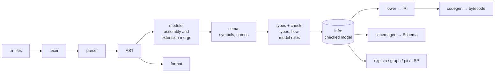

# Plan: the ReasonR compiler

| | |
|---|---|
| **Basis** | [RFC-0001](../rfc/0001-reasonr-language/README.md), stages 1 and 2 of the implementation plan (§38) |
| **Status** | Approved; the decisions of §2 are in RFC-0001 (revision 5). Done — the plan is kept as a record of the decisions and the progress |
| **Date** | 2026-10-02 |
| **Implementation language** | Go 1.23+ |
| **Note** | Paths, package names and RFC section numbers are those of the time (the repository `tycheg/reasonr` before the split) |

---

## Contents

1. [Goal and scope](#1-goal-and-scope)
2. [Decisions to fix before the start](#2-decisions-to-fix-before-the-start)
3. [Architecture](#3-architecture)
4. [Repository layout](#4-repository-layout)
5. [Stage 0. Skeleton](#5-stage-0-skeleton)
6. [Stage 1. Lexer](#6-stage-1-lexer)
7. [Stage 2. AST and parser](#7-stage-2-ast-and-parser)
8. [Stage 3. Formatter](#8-stage-3-formatter)
9. [Stage 4. Module and tenant extensions](#9-stage-4-module-and-tenant-extensions)
10. [Stage 5. Symbols and name resolution](#10-stage-5-symbols-and-name-resolution)
11. [Stage 6. Type system and body checking](#11-stage-6-type-system-and-body-checking)
12. [Stage 7. Model checks](#12-stage-7-model-checks)
13. [Stage 8. IR](#13-stage-8-ir)
14. [Stage 9. Schema and compatibility check](#14-stage-9-schema-and-compatibility-check)
15. [Stage 10. Bytecode generation](#15-stage-10-bytecode-generation)
16. [Stage 11. CLI](#16-stage-11-cli)
17. [Stage 12. LSP and editor](#17-stage-12-lsp-and-editor)
18. [Diagnostics](#18-diagnostics)
19. [Testing](#19-testing)
20. [Performance](#20-performance)
21. [Schedule and milestones](#21-schedule-and-milestones)
22. [Risks](#22-risks)
23. [Compiler acceptance criteria](#23-compiler-acceptance-criteria)
24. [Progress](#24-progress)

---

## 1. Goal and scope

**Goal:** a compiler that turns a `*.rr` module (the base model and, if present, a tenant extension) into:

1. **diagnostics** — errors and warnings with a position, an explanation and a hint, for people and as JSON for agents;
2. **a checked model** — AST + symbol tables + types; the LSP, `explain`, `graph`, `pii` work on it;
3. **the schema** `reasonr.Schema` (RFC §30.5) — the engine builds storage, the API and the UI from it;
4. **IR and bytecode** — what the interpreter runs.

**In the plan:**

- lexer, parser, AST;
- the formatter `reasonr fmt`;
- module loading, merging tenant extensions;
- name resolution, the type system, flow narrowing;
- all semantic checks E00xx–E10xx and warnings W1xxx;
- IR, schema generation, the model version compatibility check;
- bytecode generation — its format is agreed with the interpreter;
- CLI: `check`, `fmt`, `explain`, `graph`, `pii`;
- the LSP server and the VS Code extension.

**Not in the plan** (separate plans):

- the interpreter (VM) and the in-memory engine;
- the test runner `reasonr test`. The compiler only checks and compiles tests: rules E08xx, IR for `given`/`when`/`then`;
- the PostgreSQL engine, migration generation, the UI.

---

## 2. Decisions to fix before the start

Working through the grammar found places the RFC left ambiguous. The decisions below are **approved and in RFC-0001** (revision 5).

| # | Ambiguity | Example | Proposed decision |
|---|---|---|---|
| 1 | `[a]` — an entity access or a one-element list | `if [id]` and `exclude: [d1]` | The parser builds a common `BracketExpr` node and type checking decides its meaning. If a collection (`list`, `set`) is expected, it is a literal. If there is one element of an identifier type and no collection is expected, it is an entity access. If the element is a type name (`[Order]`), it is a search. In all other cases it is a literal |
| 2 | Keywords that clash with names | `request PageRequest` — a parameter, but `request` is a keyword of external systems; also `page`, `sort`, `where`, `select`, `limit`, `time`, `after`, `id`, `to`, `on`, `as`, `all` | Split them into **reserved** and **contextual** ([§6.2](#62-keywords)). The lexer emits contextual words as `IDENT`, and the parser recognizes them by position |
| 3 | An enum value matches a variable or field name | `free` — a `DriverStatus` value and the name of a local variable | The variable, field or parameter wins. If an enum with that value is also expected in the context, ambiguity error E0105 is reported with the hint to write `DriverStatus.free` |
| 4 | The type of `[x]` in commands | `[x]` in a command should show existence, but not fields | In commands `[x]` has type `Ref<Order>?` — an opaque reference without field access. In queries of its own type `[x]` has type `Order?` — a record with fields |
| 5 | A bare `return` in a query | `orderNotFound()` then `return` | Allowed only if an error has already been raised on this path. Otherwise error E0507 "a query must return a value or an error" |
| 6 | Indentation step | RFC: 2 spaces | The lexer requires a block to open with exactly 2 more spaces (E0003). A block may close to any open level |
| 7 | Escaping interpolation | `"{x}"` | `{{` and `}}` are literal braces. Inside `{ }` any expression is allowed except strings with interpolation |
| 8 | The argument of `delete` | `delete searchTimer` (`Timer.Id?`), `delete [martId]` | `delete` takes `Timer.Id`, `Timer.Id?` or a projection access; there are no other forms |
| 9 | A value constructor call as a statement | `Money(amount: 1, currency: rub)` on its own line | Error E0213 "value is not used". At statement level `Type(...)` is allowed only for a projection upsert |
| 10 | Implicit personal data flows | `if phone == "x"` then writing a constant | The compiler tracks only explicit flows (assignments, arguments). Implicit flows through conditions are not tracked — the RFC records this as a known limitation |

---

## 3. Architecture

### 3.1. Pipeline



### 3.2. Principles

1. **The lexer and the parser are hand-written**, without generators. This is needed for good error recovery, clear messages and keeping comments for the formatter.
2. **The compiler does not stop at the first error.** Every phase works on damaged input: `Bad*` nodes, the `Invalid` type, suppression of cascading errors.
3. **The checked model is an immutable `Info` structure** in the spirit of `go/types.Info`: the tables `Types[expr]`, `Uses[ident]`, `Calls[call]`, `Narrowings` and so on. All later phases and tools use it; no phase recomputes types.
4. **Determinism.** The same input gives byte-identical IR, schema and bytecode: a stable traversal order, no iteration over a `map` without sorting. The hash in `rt_schema_versions` depends on it.
5. **No external dependencies in the core.** The Go standard library. The exception is the LSP protocol, if we decide not to write it ourselves ([§17](#17-stage-12-lsp-and-editor)).
6. **The compiler is not on the hot path**, so allocations are acceptable in it. The garbage-free requirement applies to the runtime.

### 3.3. Types shared with the engine

The types of the "interpreter ↔ engine" boundary (RFC §30: `Value`, `Record`, `Schema`, `UnitOfWork`…) live in the root package `reasonr`. The compiler **produces** `Schema`, the interpreter and the engines **consume** it. The compiler packages live in `compiler/...` and do not depend on the engine.

---

## 4. Repository layout

```
go.mod                         module github.com/tycheg/reasonr
reasonr/                       shared boundary types (RFC §30): Value, Record, Schema, UoW, Env
compiler/
  source/                      FileSet, positions, line tables
  diag/                        diagnostics, code registry, text/json rendering, i18n
  token/                       token kinds, keywords
  lexer/                       tokenization, INDENT/DEDENT, literals, interpolation
  ast/                         nodes, traversal (Walk/Inspect), positions
  parser/                      recursive descent, error recovery
  format/                      reasonr fmt
  module/                      loading a directory, *.test.rr, tenants/, merging extend
  sema/                        symbols, scopes, namespaces
  types/                       type representation, compatibility, default values
  check/                       body checking, flow narrowing, model rules (E03–E10)
  constant/                    evaluating constant expressions (check on default values)
  ir/                          typed linear IR
  lower/                       Info → IR
  schemagen/                   Info → reasonr.Schema
  compat/                      comparing two model versions (RFC §32)
  codegen/                     IR → bytecode
  tools/                       explain, graph, pii
cmd/reasonr/                   CLI
lsp/                           LSP server
editors/vscode/                VS Code extension: TextMate grammar + LSP client
examples/
  taxi/                        the canonical example of RFC §25
  bank/                        the example of RFC §26
testdata/                      golden tests by phase
```

---

## 5. Stage 0. Skeleton

**Tasks:**

1. `go.mod`, the directory layout, a `Makefile` or `Taskfile`.
2. CI (GitHub Actions): `go vet`, `staticcheck`, `go test -race ./...`, a `gofmt` check, a short fuzz run.
3. Package `source`: `FileSet`, `Pos` (byte offset), `Position` (file, line, column in runes), the table of line starts.
4. Package `diag`: the `Diagnostic` structure, the code registry, text and JSON rendering ([§18](#18-diagnostics)).
5. Infrastructure for golden tests and for tests with expectations right in the sources: `# want "E0304"` ([§19](#19-testing)).
6. Move the RFC examples into `examples/taxi` and `examples/bank`, one file per `rr` block.

**Done when:** CI is green, `go test ./...` passes, the golden runner can update the expected files with the `-update` flag.

---

## 6. Stage 1. Lexer

### 6.1. Tokens

| Group | Tokens |
|---|---|
| Structure | `NEWLINE`, `INDENT`, `DEDENT`, `EOF` |
| Names | `IDENT` (case is checked later) |
| Literals | `INT`, `DECIMAL` (with a point), `DURATION` (`500ms`, `30s`, `5m`, `2h`, `1d`), `STRING` (with interpolation parts), `DATE` (`date"…"`), `TIMESTAMP` (`timestamp"…"`) |
| Brackets and separators | `(` `)` `[` `]` `,` `.` `:` |
| Operators | `=` `==` `!=` `<` `<=` `>` `>=` `+` `-` `*` `/` `%` `?` `?.` `??` |
| Comments (trivia) | `COMMENT` (`#`), `DOC` (`##`) — not in the main stream, kept separately |

`<` and `>` are both generic brackets (`list<T>`) and comparison operators. The lexer does not tell them apart: the parser decides by context — a type or an expression.

### 6.2. Keywords

**Reserved** — cannot be names:

```
entity actor value enum projection external role view control migration test
tenant extend command event notification error query rule request index
let if else for in while break continue return delete forget
and or not is none true false new
```

**Contextual** — ordinary `IDENT`s that become keywords only in their position:

```
id unique personal check timeout was action on
where sort page limit select desc all
after hasErrors now today me caller schedule self
given when then as via matches time passes exclude because to
```

`request` stays reserved; the page parameter in the RFC examples is renamed `pageReq`.

### 6.3. Indentation algorithm

- A stack of indentation levels, `[0]` at the start.
- Empty lines and lines with only a comment do not affect indentation.
- **Inside `(` and `[` newlines are ignored** (implicit line joining, as in Python). This lets long calls wrap.
- A new line indented more than the top of the stack: exactly `+2` is allowed, otherwise E0003; an `INDENT` is emitted.
- Less indentation: pop levels from the stack, one `DEDENT` each. If the level is not on the stack, E0004 "inconsistent indentation".
- A tab in indentation is E0002; the character counts as 2 spaces so the lexer can go on.
- At the end of the file a `NEWLINE` and all remaining `DEDENT`s are emitted.

### 6.4. Literals

- Numbers: `1_000_000`. A number with a point is `DECIMAL`; type checking decides whether it becomes `decimal` or `float`. Leading zeros and `1.` without a fractional part are errors.
- A duration is a number followed **without a space** by the suffix `ms|s|m|h|d`. `30 s` is two tokens and ends up a syntax error.
- Strings: `"…"`, escapes `\" \\ \n \t \u{…}`, interpolation `{expression}`, literal braces `{{` and `}}`. The lexer handles interpolation recursively: `STRING` holds a list of "text / expression tokens" parts.
- `date"…"` and `timestamp"…"` are prefixed literals; the lexer checks the format right away (E0006).

### 6.5. Result of the stage

- `lexer.Scan(file) → []Token + []Comment + []Diagnostic`.
- Fuzz test `FuzzLexer`: the lexer does not panic and always terminates; the total length of tokens and trivia equals the input length.
- Errors: E0001 (unknown character), E0002 (tab), E0003 (indentation step), E0004 (inconsistent indentation), E0005 (unterminated string), E0006 (invalid date or time literal), E0007 (invalid number).

---

## 7. Stage 2. AST and parser

### 7.1. Node catalog

| Category | Nodes |
|---|---|
| File | `File{Tenant, Decls, Comments}` |
| Top-level declarations | `RoleDecl`, `EnumDecl`, `ValueDecl`, `EntityDecl{IsActor}`, `ProjectionDecl`, `ExternalDecl`, `ViewDecl`, `ControlDecl`, `MigrationDecl`, `TestDecl`, `ExtendDecl{IsView}`, `ExcludeDecl`, `TopLet` |
| Members | `IDDecl`, `FieldDecl`, `IndexDecl`, `CommandDecl`, `EventDecl`, `NotificationDecl`, `ErrorDecl`, `QueryDecl`, `RuleDecl`, `OnDecl`, `CheckDecl`, `MethodDecl`, `RequestDecl` |
| Views | `ActionItem{Target, Args, Control, Children}`, `ChildView` |
| Types | `NamedType{Path}` (`Order`, `Order.Id`), `GenericType{Name, Args}`, `OptionalType` |
| Statements | `LetStmt`, `AssignStmt`, `IfStmt`, `ForStmt`, `WhileStmt`, `BreakStmt`, `ContinueStmt`, `ReturnStmt`, `ExprStmt{Call, To}`, `DeleteStmt`, `ForgetStmt`, `BadStmt` |
| Expressions | `Ident`, `BasicLit`, `InterpString`, `UnaryExpr`, `BinaryExpr`, `IsNoneExpr`, `InExpr`, `SelectorExpr`, `CallExpr{Fun, Args []NamedArg, Safe}`, `BracketExpr{Elems}`, `MapLit`, `SearchExpr{Type, Where, Sort, Page, Limit, Select}`, `NewIDExpr`, `BadExpr` |
| Tests | `GivenBlock`, `WhenBlock`, `ThenBlock`, `TestCall{Call, As, Via}`, `TimePasses`, `ThenNotification`, `ThenError`, `ThenRequest`, `ThenMatches` |

Every node has `Pos`/`End`. Declarations have a `Doc` field with the attached `##` comment.

### 7.2. Parsing expressions

- Precedence is parsed by precedence climbing over the table of RFC §8.1.
- Postfix operations in a loop: `.name`, `?.name(...)`, `(...)`.
- `[`: the parser reads a comma-separated list of elements. If inside there is one capitalized name and `]` is followed by `NEWLINE INDENT` with `where`/`sort`/`page`/`limit`/`select`, the result is a `SearchExpr`. Otherwise it is a `BracketExpr`, and type checking decides its meaning ([§2](#2-decisions-to-fix-before-the-start), item 1).
- A map literal: `[` expression `:` …; the empty map is `[:]`.
- Call arguments are **named only**. A positional argument is E0010 with a hint of the parameter name; type checking adds the hint when the signature is known.
- `new` + a type path ending in `.Id` is a `NewIDExpr`.

### 7.3. Parsing statements

A statement that starts with `IDENT` or `[` is parsed as an expression. Then:

- followed by `=` — an `AssignStmt`, only an `Ident` is allowed on the left;
- the expression is a call, then an optional `to <expression>` — an `ExprStmt`;
- otherwise — E0011 "an expression cannot be a statement".

### 7.4. Parsing declarations

- An entity member starting with `IDENT`: if it is the contextual `id`, an `IDDecl`, otherwise a `FieldDecl` (`name Type [= value] [personal[(path)]] [was name]`).
- A value object member: `IDENT (` is a method, `IDENT` + type is a field, `check` is an invariant.
- The body of an event is optional: it is there if the header is followed by `INDENT`.
- Access — `command(...)`, `query(...)`, `view(...)` — is a list of `IDENT`s in parentheses right after the keyword.
- `external` holds `request name(parameters) [timeout duration]`.

### 7.5. Error recovery

- **Inside a statement:** on an error, skip tokens up to `NEWLINE`, respecting bracket nesting, and create a `BadStmt`.
- **At member and declaration level:** skip to `DEDENT` or to the next reserved word at the start of a line.
- **Cascade suppression:** if there is already an error at this place, the next one is not reported.
- Limit: 100 syntax errors per file, then "too many errors".

### 7.6. Result of the stage

- `parser.ParseFile(fset, name, src) → *ast.File + []Diagnostic`.
- Golden tests: an AST dump for every construct of the RFC.
- Fuzz test `FuzzParser`: no panics; any input gives an AST whose node positions nest correctly.
- Every `rr` block of the RFC parses without errors.

---

## 8. Stage 3. Formatter

**Approach** — as in `go/printer`: printing the AST and placing comments back by position.

1. The canonical form:
   - 2-space indentation;
   - one empty line between members of different kinds, no empty lines between members of one kind (fields, errors, notifications);
   - spaces around binary operators;
   - `name: value` in arguments;
   - aligned trailing comments in a group of lines.
2. Comments:
   - `##` stay above the declaration;
   - trailing `#` stay on the same line;
   - standalone `#` go between nodes, by position.
3. Long lines (over 120 characters): call arguments wrap one per line inside the parentheses.
4. The formatter **does not change meaning**: checked by the test `parse(fmt(src))` ≅ `parse(src)` — the ASTs are equal ignoring positions.
5. **Idempotence**: `fmt(fmt(src)) == fmt(src)`, checked by a fuzz test on the corpus.
6. If a file has syntax errors, the formatter returns the source unchanged and an error.

**Done when:** every example in `examples/` is stable under `fmt`, and properties 4 and 5 hold on the fuzz corpus.

---

## 9. Stage 4. Module and tenant extensions

1. **Loading.** The module directory:
   - `*.rr` — the model;
   - `*.test.rr` — tests;
   - `tenants/<name>/*.rr` — extensions.

   Files are walked in sorted order so the result is deterministic.
2. **Building the effective model** for `--tenant t`: the base files + the files of `tenants/t/`. Tenant files must have the header `tenant t` (E1001); base files must not.
3. **Merging `extend`:**
   - `extend Order` adds members to `EntityDecl Order`; if there is no base declaration, E1002;
   - a name clash with base members — E1003;
   - a `rule` in an extension with the same name replaces the body of the base rule, and the signature must match (E1004). A rule without a base declaration — E1005;
   - `on <event>` is attached to the entity, the event must exist (E1006);
   - `extend view X` adds actions and child views;
   - `exclude test "…" because "…"` excludes a base test; a test that does not exist — E1007.
4. Every member remembers its origin (`base` or `tenant:t`). This is needed for `Schema.FieldInfo.Tenant` and for diagnostics: the position points into the tenant file.
5. Without `--tenant` only the base model is compiled. `reasonr check --all-tenants` checks the base and every tenant.

---

## 10. Stage 5. Symbols and name resolution

### 10.1. Passes

1. **Collecting global symbols:** types (entities, actors, projections, values, enums, external systems, views, controls) and roles. Duplicates — E0101.
2. **Collecting the members of each type** by the namespaces of RFC §23:
   - methods: commands, events, notifications, errors, queries, rules;
   - fields and indexes.

   Conflicts — E0102.
3. **Resolving type expressions:**
   - the types of fields, parameters and results;
   - `Order.Id` → `IDType(Order)`;
   - `Timer.Id` → a built-in type;
   - for a projection with `id Order.Id` an `IDType(OrderMart, base=IDType(Order))` is created.
4. **Name resolution in bodies** is done together with type checking ([§11](#11-stage-6-type-system-and-body-checking)), because enum values need the expected type.

### 10.2. Scopes

`Universe` (built-in types and functions) → `Module` (global symbols) → `Type` (entity fields and methods) → `Method` (parameters) → `Block` (`let`, `for` variables).

The rule of RFC §11.3 "fields, parameters and variables do not coincide" is checked when a parameter or a variable is declared: a lookup in the `Type` and `Method` scopes (E0103). Shadowing in nested blocks is forbidden too (E0104).

### 10.3. Name style

Checked when symbols are collected (E0106):

- types — capitalized;
- public commands and queries — capitalized;
- private commands, queries, events, errors, fields — lowercase.

### 10.4. Access resolution

Each item of the list in `command(...)`, `query(...)`, `view(...)` is resolved in this order:

1. `self` — only in actors (E0601);
2. an entity field of type `Actor.Id` or `Actor.Id?` (E0602 if the field has another type);
3. an actor;
4. a role.

A name that matches both a role and a field — E0603. An unknown name — E0604 with a hint of the closest one by Levenshtein distance.

---

## 11. Stage 6. Type system and body checking

### 11.1. Type representation

```go
type Type interface{ typ() }

type (
	Basic    struct{ Kind BasicKind }             // int, bigint, float, decimal, string, bool, uuid, date, time, timestamp, duration, bytes
	Optional struct{ Elem Type }
	List     struct{ Elem Type }
	Set      struct{ Elem Type }
	Map      struct{ Key, Elem Type }
	Page     struct{ Elem Type }
	Enum     struct{ Decl *sema.Type }
	Value    struct{ Decl *sema.Type }             // value object
	ID       struct{ Owner *sema.Type; Base Type } // Order.Id; Base — uuid/bigint/string/Value/ID
	TimerID  struct{}
	Ref      struct{ Owner *sema.Type }            // [x] in commands: a reference without fields
	Record   struct{ Owner *sema.Type }            // [x] in queries, after: a record with fields
	Caller   struct{}
	PageReq  struct{}
	Void     struct{}
	Invalid  struct{}                              // after an error; compatible with everything, suppresses cascades
)
```

### 11.2. Bidirectional checking

Type checking runs in two modes:

- `infer(e) → T` — the type is inferred from the expression itself;
- `check(e, expected)` — the expression is checked against an expected type.

The expected type comes from a call parameter, the declared type of `let x T`, the type of a field in an event, the result type in `return`, the other operand of a comparison.

What depends on the expected type:

- **numeric literals:** without context — `int` for integers and `decimal` for fractions; `float` only when it is expected;
- **`[]` and `[a, b]`:** `list` or `set` by the expectation; without context — `list`;
- **enum values** like `searching` are resolved when an enum is expected;
- **a `BracketExpr` with one element** — by the rule of [§2](#2-decisions-to-fix-before-the-start), item 1.

### 11.3. Compatibility

- `T` is assignable to `T?` (lifting).
- There are no other implicit conversions.
- Explicit conversions: `int()`, `bigint()`, `float()`, `decimal()`, `string()`, and `OrderMart.Id(x)` ⇄ `Order.Id(x)` for derived identifiers.
- Equality is allowed between `T` and `T?`, structural for values and collections.
- Ordering (`<`, `>` and so on) — only for numbers, dates, times, durations and strings.

### 11.4. Call resolution

The result is written to `Info.Calls[call]`:

| Form | Where | Options |
|---|---|---|
| `name(...)` | command | own command, event, notification, error, rule, built-in function (`schedule`) |
| `name(...)` | query | own rule, error, built-in function |
| `Type(...)` | expression | value object constructor |
| `Type(...)` | statement | projection upsert |
| `Type.Id(...)` | expression | identifier conversion |
| `Type.name(...)` | statement | a request to an external system |
| `Type.name(...)` | expression in a query | a call of another type's query |
| `[x].name(...)` / `[x]?.name(...)` | command | a command of another entity |
| `x.method(...)` | everywhere | a value object method or a built-in method of a collection, string, time |

Argument checks:

- every required parameter is passed (E0203);
- no extra (E0204) or repeated (E0205) ones;
- the type of every argument is checked in `check` mode.

### 11.5. Flow narrowing

While a body is checked, an environment of facts is kept: `facts: Symbol → narrowed type`.

- Analyzing a condition returns a pair (`whenTrue`, `whenFalse`):
  - `x is none` → (`x: none`, `x: T`);
  - `if [x]` → the same for `x`;
  - `a and b`: `whenTrue` = `whenTrue(a) ∪ whenTrue(b)`;
  - `a or b`: `whenFalse` = `whenFalse(a) ∪ whenFalse(b)`;
  - `not a` swaps `whenTrue` and `whenFalse`.
- `if c` + a block:
  - inside the block `whenTrue(c)` holds;
  - if the block always exits (`return`, `break`, `continue` on every path), `whenFalse(c)` holds after the `if`;
  - otherwise after the `if` — the intersection of the facts true after both branches.
- A fact about a local variable is dropped when it is assigned. **Fields inside a command are immutable**, so facts about fields live until the end of the command. This follows directly from RFC §11.5.
- Loops: before the loop body, facts about every variable the body assigns are dropped (a preliminary pass over the body).
- Narrowable expressions: variables, parameters, fields and field chains of immutable records (`o.driver`, where `o` is declared with `let` and not reassigned).

### 11.6. Context restrictions

The "what is allowed where" table is checked while walking a body, by the kind of context.

| Construct | Command | Event | Query | Rule | Value method | `on` reaction | Test | Migration | View |
|---|---|---|---|---|---|---|---|---|---|
| Field assignment | — | ✓ | — | — | — | — | — | — | — |
| `let`, `if`, `for`, `while` | ✓ | — | ✓ | ✓ | ✓ | ✓ | ✓ | ✓ | — |
| Calling an event, notification, error | ✓ | — | error | — | — | ✓ | — | — | — |
| Calling a command | ✓ | — | — | — | — | ✓ | ✓ (public) | ✓ | — |
| Projection upsert/delete, `schedule`, `delete`, `forget`, external request | ✓ | — | — | — | — | ✓ | — | — | — |
| `[Type]` search, `[x]` as a record | — | — | ✓ | — | — | — | — | — | — |
| `[x]` as a reference | ✓ | — | — | — | — | ✓ | — | ✓ | — |
| `now`, `today`, `new` | ✓ | — | ✓ (not `new`) | — | — | ✓ | ✓ | ✓ | `new` |
| `after` | ✓ | — | — | — | — | ✓ | — | — | — |
| `me` | with `(<Actor>)` access | — | with `(<Actor>)` access | — | — | — | — | — | with `(<Actor>)` access |
| `all <Entity>` | — | — | — | — | — | — | — | ✓ | — |
| Calling a rule | ✓ | **—** | ✓ | ✓ | — | ✓ | — | ✓ | — |

Violations give E03xx errors. The message names the context: "`now` cannot be used in an event: events must be replayable".

### 11.7. Default values

The rules of RFC §7.3:

- a default value is computed for every field;
- a field of an identifier type without `?` — E0210;
- a value object without a default value — E0211.

To find out whether a value object has a default value, its default fields must pass `check`. For that the `constant` package evaluates pure expressions over constants. If `check` cannot be evaluated statically (it calls a method with a loop and so on), we assume there is no default value and require `T?` or an explicit value. An explicit `= expression` on a field must be constant too (E0212).

### 11.8. Path analysis

- A query must end every path with `return expression`, or with `return` after raising an error (E0507).
- A rule and a value method must end every path with `return expression` (E0508).
- Unreachable code after `return`, `break`, `continue` — warning W1002.

---

## 12. Stage 7. Model checks

The checks run over `Info` after stage 6. Each is a separate analyzer with a common interface; they can be enabled and tested one by one.

```go
type Analyzer struct {
	Name     string
	Codes    []diag.Code
	Requires []*Analyzer
	Run      func(*Pass) error
}
```

### 12.1. Call graph (E04xx)

- Nodes are commands (`Entity.command`).
- Edges:
  - calls of own commands, `[x].cmd` and `[x]?.cmd`;
  - for extensions: from every command that raises event E to the commands that the `on E` reactions call.
- `schedule(run: …)` creates no edge: a timer runs in a separate unit of work.
- Strongly connected components (Tarjan). A component of two or more nodes, or a self-loop — E0401 "command recursion", with the cycle path in the message. Reentrancy (A → B → another command of A) is not a cycle and is allowed.
- The `run` of `schedule` is a command of the current entity (E0402).
- The graph is kept in `Info` for `reasonr graph` and `explain`.

### 12.2. Queries and indexes (E05xx)

The algorithm that picks an index for `[T]` with `where`/`sort`:

1. `where` is split into a conjunction of comparisons `path op expression`. `or`, `not` and comparing two fields — E0501.
2. The right side must not depend on the record's fields: parameters, `me`, `now`, literals are allowed (E0502).
3. Matching an index with keys `k1..kn`:
   - `==` and `in` conditions must cover a prefix `k1..kj`, the order in `where` does not matter;
   - at most one range condition (`<`, `<=`, `>`, `>=`) — on `k(j+1)`;
   - `sort` must match the continuation of the keys after the equalities, with the same or all reversed directions;
   - `!=` is not supported by an index — E0503 with a hint to rewrite it with `in`.
4. If several indexes fit, the longest covered prefix wins; on a tie, the first declared one. The choice is written into the IR (`IndexRef`).
5. **If no index fits — E0504 with a ready hint**: "add `index byCustomerPlacedAt(customer, placedAt desc)`". This matters for agents: the fix can be applied mechanically.
6. Neither `page` nor `limit` — E0505; `limit` over 100 — E0506.
7. A query result is a value object, `page<V>` or `list<V>` (E0509). `select` builds this `V`.
8. `[T]` and reading the fields of `[x]` — only in queries of its own type (E0510).
9. Indexes on personal fields: only `==` and `in`, no `desc` and no sorting (E0905).

### 12.3. Uniqueness

- The error named in `unique <error>` must be declared (E0511).
- Its parameters must match by name and type the last segments of the index paths (E0512).

### 12.4. Access (E06xx)

- Only public methods have access brackets (E0605).
- A public command without brackets — warning W1010 "available to any authenticated user; is that intended?".
- `self` — only in actors; a field — only in commands, not in queries and views (E0606).

### 12.5. Views (E07xx)

- An action refers to a public command or query (E0701).
- Fixed arguments are type-checked; the ones not passed become form fields.
- Required arguments that are not passed and cannot be entered in a form (an identifier type without a source) — E0702.
- `item` inside a query action has the type of a result element; the fields used are checked (E0703).
- The type of `control X` matches the type of the action result (E0704).
- A child view exists and its parameters are passed (E0705).
- Views unreachable from the root ones (not a child of any view) — warning W1011.

### 12.6. Tests (E08xx)

- `given`: only calls of **public** commands and `time passes` (E0801).
- `when`: exactly one action (E0802).
- `as` resolves to an actor identifier or a role (E0803).
- `then`:
  - `error` and `notification` refer to declared items;
  - `request` — to a declared external system request;
  - `matches` — to the fields of the result type (E0804).
- `via` — an existing view (E0805).

### 12.7. Personal data (E09xx)

Taint analysis of marked values:

- **A label** is a set of subject types, for example `{Customer}`.
- **Sources:**
  - reading a field with `personal(...)` (in commands — one's own, in queries — of a record);
  - a parameter with `personal`;
  - an event argument in an `on` reaction.
- **Propagation:**
  - any operator, method, interpolation, value constructor → the union of the operand labels;
  - local variables use a flow-insensitive analysis: the label of a variable is the union of the labels of all its assignments. Conservative and simple.
- **Sinks and rules:**
  - assigning a field in an event: the field must be `personal`, its subject type ∈ label, and the label holds exactly one subject (E0901, E0902);
  - an event argument, a projection upsert, an external request: the parameter must be `personal` with the same subject type (E0902);
  - a command call argument: the command parameter must be `personal` (E0903). This keeps the analysis **modular**: the contract is fixed in the signature, and no interprocedural analysis is needed;
  - a query result and a notification argument — allowed;
  - an `if` condition, a `where` key — allowed (implicit flows are not tracked, see [§2](#2-decisions-to-fix-before-the-start), item 10).
- Personal fields and event parameters must be `T?` (E0904).
- `forget x`: `x` is an entity identifier. If the entity has no personal data, neither as a subject nor in other entities' fields — warning W1020.
- A non-personal command parameter that reaches a personal sink — W1021.
- The result of the analysis (the map "field → subject → sinks") is kept for `reasonr pii`.

### 12.8. Other checks

| Code | Check |
|---|---|
| E0206 | `[x].cmd()` with an optional `x` — `[x]?.cmd()` is needed |
| E0207 | `?.` applied to a non-optional value that is not an entity access |
| E0208 | `delete`: the argument is not `Timer.Id`/`Timer.Id?` and not a projection access |
| E0209 | `to <expression>`: not an actor identifier |
| E0213 | A value is not used (a value constructor as a statement) |
| E1001–E1007 | Extensions ([§9](#9-stage-4-module-and-tenant-extensions)) |
| W1001 | Unused declarations: a field, event, error, rule, private command |
| W1003 | `while` without an obvious exit |
| W1004 | A command call in a loop over a collection of unbounded size |
| W1005 | `float` in a field or parameter tied to money (the name contains `price`, `amount`, `sum`, or the type is inside `Money`) |
| W1006 | A notification without `to` in a command reachable only from timers |

---

## 13. Stage 8. IR

### 13.1. Levels

1. **HIR = AST + `Info`.** There is no separate structure. The LSP and the tools work on HIR.
2. **LIR — a linear typed IR** for every function: a command, an event (its apply function), a query, a rule, a value method, a reaction, a test step. It is close to bytecode but stays readable for debugging (`reasonr build --dump-ir`).

### 13.2. An LIR function

```
func Order.DriverFound(driverId: Driver.Id) kind=command access=[role matching]
  slots: r0 Driver.Id (param), r1 OrderStatus, r2 bool, r3 Timer.Id?, r4 timestamp, r5 Timer.Id, ...
  b0:
    r1 = field status
    r2 = ne.enum r1, const OrderStatus.searching
    br r2, b1, b2
  b1:
    ret
  b2:
    r3 = field searchTimer
    timer.delete r3
    r4 = add.ts now, const 20s
    r5 = schedule r4, Order.expireOffer(driverId: r0)
    event offerSent(driverId: r0, timer: r5)
    ...
    cmd [r0] Driver.offerOrder(orderId: id, pickup: r8, orderPrice: r9)
    ret
```

### 13.3. Operation set

| Group | Operations |
|---|---|
| Data | `const`, `move`, `field` (snapshot), `after.field`, `param`, `rec.get` (record field), `val.new`, `val.get`, `coll.*`, `opt.wrap`, `opt.isnone` |
| Arithmetic and comparisons | typed: `add.i64`, `add.dec`, `add.ts`, `cmp.str`, `eq.rec`… |
| Control | `br`, `jmp`, `ret`, `ret.val`, `loop.guard` (an iteration counter for the engine limit) |
| Effects | `event`, `notify [to]`, `error`, `cmd [ref] / cmd? [ref]`, `proj.upsert`, `proj.delete`, `schedule`, `timer.delete`, `request`, `forget` |
| Reads | `ref.exists`, `rec.load [x]`, `find spec`, `query.call` |
| Built-in | `now`, `today`, `newid T`, `haserrors`, `me`, `caller.roles`, `rule.call`, `intrinsic <stdlib>` |

### 13.4. Lowering

- Reading a field in a command → `field`. Reading through `after` → `after.field`: the interpreter applies the accumulated events to a copy of the state.
- An event body → an apply function `apply.<event>(state, args) → state` made of a sequence of assignments.
- `SearchExpr` → `find` with a **`FindSpec` template**: the chosen index, conditions with argument slot numbers, the sort, the page or the limit; then a `select` loop over the rows. The template is built at compile time; at run time only the values are filled in.
- Logical `and`/`or` → branches (lazy evaluation).
- String interpolation → `intrinsic str.concat` over the parts.
- A `rule` in a tenant extension → the tenant body; in the base program → the base body.
- `on E` reactions → calls inserted at the end of the command that raised E. The order is the order the events were raised.

### 13.5. Optimizations (minimal)

- Constant folding.
- Removing unreachable blocks.
- Reusing temporary value slots.

Nothing else: the compiler must stay simple, and the VM provides the performance.

### 13.6. Serialization

- A versioned binary format, deterministic order, a SHA-256 hash.
- Stored in `rt_schema_versions.ir`.
- Test: `encode(decode(x)) == x`, plus a golden dump for the examples.

---

## 14. Stage 9. Schema and compatibility check

### 14.1. Schema generation

`schemagen` builds `reasonr.Schema` (RFC §30.5) from `Info`:

- **The references `TypeRef`, `FieldRef`, `MethodRef`, `IndexRef`** are indexes into sorted lists (by kind, then by name). They are internal numbers for the bytecode. **Data in storage refers to names, not numbers**, so the numbers may change between versions.
- **Personal fields:** `Personal{Subject, SubjectType}`.
- **Indexes:** keys, uniqueness, the error name.
- **Methods:** kind, visibility, access, parameters (with `personal`), result, `timeout`.
- **Extension fields** are marked with the tenant.

Golden test: a JSON dump of the schema for `examples/taxi` with and without the tenant `acme`.

### 14.2. Version compatibility

The command `reasonr check --against <old schema>` compares two schemas by the rules of RFC §32:

| Change | Result |
|---|---|
| A new type, field, method, index; a new event argument with a default value; `was` for renames; a field became `personal` | OK |
| A new unique index | Warning: the engine checks the data for duplicates during migration |
| A field type changes | Error E1101 "a manual migration is needed" if the module has none |
| Removing an event argument, changing its type, renaming an event | **Error E1102** — forbidden |
| Removing a command | Warning W1101: if timers refer to it, a migration is needed (the engine checks this against the data) |
| Removing a field | Warning W1102: the data will be lost |
| A field became optional or the other way round | The other way round (`T?` → `T`) — error E1103 |

The result is a machine-readable report. The engine uses it to build the migration plan.

---

## 15. Stage 10. Bytecode generation

This stage is done **together with the interpreter**: the instruction set and the frame format are designed together with the VM. The compiler's tasks:

1. **Register allocation.** LIR slots map to frame registers separately by kind (`int64`, `float64`, `dec128`, ref slots in the arena) — needed for a VM without boxing (RFC §29.2). Temporary slots with non-overlapping live ranges share a register (linear scan).
2. **Instruction encoding:** 32-bit words (an 8-bit opcode + operands) with an extension for wide operands, a constant pool per module, a function table.
3. **Superinstructions** for frequent pairs, for example `field` + `cmp.enum` + `br` → `brfield.enum`. The set is chosen from a profile of the examples.
4. **`FindSpec` templates** and command call tables (by `MethodRef`) are passed as function metadata.
5. **Deterministic serialization**, a hash, a format version.
6. Test: compiling `examples/` → disassembly → golden.

**Done when:** the interpreter runs the bytecode of the examples and the taxi scenario tests pass on the in-memory engine. This is a criterion shared with the interpreter plan.

---

## 16. Stage 11. CLI

| Command | Description |
|---|---|
| `reasonr check [path] [--tenant t \| --all-tenants] [--format text\|json] [--against schema.json]` | Compilation and checks. Exit code: 0 — no errors, 1 — errors, 2 — a compiler failure |
| `reasonr fmt [-w] [-l] [--check] files…` | Formatting; `--check` for CI |
| `reasonr build [--tenant t] [-o out] [--dump-ir] [--dump-schema]` | IR, schema, bytecode |
| `reasonr explain Order.Cancel` | A description of a command: access, checks (conditions with errors), events, calls, effects. Built from `Info` and the call graph |
| `reasonr graph [--entity Order] [--format mermaid\|dot]` | A diagram "commands → events → calls → timers → external systems" |
| `reasonr pii [--format text\|json]` | The personal data map from the E09xx analyzer |
| `reasonr diag explain E0504` | A detailed description of an error code with a fix example |

Every command works on top of a common package: `compiler.Load(path, opts) → *Program`.

---

## 17. Stage 12. LSP and editor

### 17.1. Server

- **Protocol.** Either `go.lsp.dev/protocol` + `jsonrpc2`, or our own thin JSON-RPC with structures generated from the LSP metaModel. Decided at the start of the stage. By default — a ready library, to get results sooner.
- **Workspace model:** open documents override the files on disk. The module is the nearest directory with `*.rr` files (or an explicit `reasonr.yaml`).
- **Incrementality v1:**
  - a changed file is reparsed whole;
  - the ASTs of the other files come from a cache;
  - the semantic analysis of the module reruns with a 150 ms delay.

  Goal: 10k lines — under 100 ms from a keystroke to diagnostics. If the goal is missed, we move to per-entity analysis: only the changed entities and their dependents are rechecked.

### 17.2. Features (by priority)

1. Diagnostics (`publishDiagnostics`), warnings included.
2. Document formatting.
3. Hover: the type of an expression, a method signature, `##` documentation, the subject for personal fields.
4. Go to definition; find references.
5. Completion:
   - keywords by context;
   - members after `.` and `?.`;
   - **argument names** inside a call;
   - enum values when an enum is expected;
   - indexes in `where`.
6. Quick fixes from diagnostic hints: "add an index", "declare the error", "make the parameter `personal`", "replace `.` with `?.`".
7. Semantic highlighting (semantic tokens): tells fields, parameters, events, errors, public and private commands apart.
8. Rename (later).

### 17.3. The VS Code extension

- A TextMate grammar for basic highlighting (works without the server too).
- An LSP client, the commands `ReasonR: Format`, `ReasonR: Explain command`.
- Later: a tree-sitter grammar for highlighting on GitHub and in other editors.

---

## 18. Diagnostics

### 18.1. Structure

```go
type Diagnostic struct {
	Code     Code         // E0504
	Severity Severity     // Error | Warning
	Range    source.Range
	Message  string       // short: "no index fits the search over Order"
	Notes    []Note       // explanations with their own positions
	Fixes    []Fix        // text edits: range → replacement
}
```

### 18.2. Code registry

- Every code is declared in `diag/codes.go`: an identifier, a short name, a detailed explanation, an example of the error and an example of the fix.
- Registry test: every code has at least one negative test ([§19](#19-testing)), and the registry holds no codes that are never reported.
- Ranges:

| Range | Phase |
|---|---|
| E00xx | Lexis and syntax |
| E01xx | Names |
| E02xx | Types |
| E03xx | Effects and contexts |
| E04xx | Call graph |
| E05xx | Queries, indexes, uniqueness |
| E06xx | Access |
| E07xx | Views |
| E08xx | Tests |
| E09xx | Personal data |
| E10xx | Tenant extensions |
| E11xx | Version compatibility |
| W1xxx | Warnings |

### 18.3. Texts

- A message catalog keyed by code; the language was chosen with the `--lang` flag or the `REASONR_LANG` variable (both later removed: messages have one catalog).
- Message style:
  - say **what is wrong in terms of the model**, not of the grammar: "field "status" cannot be changed in a command", not "unexpected assignment";
  - give a **concrete hint**, with a ready fix where possible;
  - hold no internal compiler terms: slots, IR, tokens.

### 18.4. JSON for agents

```json
{
  "code": "E0504",
  "severity": "error",
  "file": "taxi/order.rr",
  "range": { "start": { "line": 412, "column": 7 }, "end": { "line": 415, "column": 60 } },
  "message": "no index fits the search over Order",
  "notes": [ { "message": "conditions: customer ==, sort: placedAt desc" } ],
  "fixes": [ { "file": "taxi/order.rr", "insertAt": { "line": 18, "column": 3 },
               "text": "index byCustomerPlacedAt(customer, placedAt desc)\n" } ]
}
```

The JSON schema is versioned and documented in `AGENTS.md`.

---

## 19. Testing

| Kind | What it checks | How |
|---|---|---|
| Unit tests | Single functions: the indentation algorithm, index matching, narrowing, type compatibility | `go test`, table tests |
| Golden tests | Tokens, AST, formatting, IR, schema, bytecode | `testdata/<phase>/<case>/` + an expected file, the `-update` flag |
| Expectations in sources | Every error and warning | As in `analysistest`: `status = cancelled  # want "E0304"`. The runner matches the reported diagnostics against the expectations by line |
| Registry test | Every code is covered by at least one `# want` case | Automatic |
| Examples | `examples/taxi`, `examples/bank`, the tenant `acme` | Compile without errors and warnings |
| RFC sync | The `rr` blocks of the RFC match the files of `examples/` | A script extracts the blocks and compares them (after `fmt`) |
| Fuzz | Lexer, parser, formatter: no panics, idempotent `fmt`, `parse(fmt(x)) ≅ parse(x)` | `go test -fuzz`; a short run in CI, an hour at night |
| Mutation tests on the examples | Every typical "agent mistake" is caught | A set of mutations of the example sources (drop a `?`, assign a field in a command, remove an index, write `phone` into a non-personal field); a specific code is expected |
| Benchmarks | Compile time and memory | [§20](#20-performance), compared with a baseline in CI |

---

## 20. Performance

| Metric | Goal |
|---|---|
| `reasonr check` of `examples/taxi` | < 50 ms |
| `reasonr check` of a 100k-line model | < 2 s, < 500 MB |
| LSP: from a keystroke to diagnostics, a 10k-line module | < 100 ms |
| `reasonr fmt` of a 5k-line file | < 20 ms |

A synthetic model generator (N entities × M commands) — for benchmarks and load on the LSP.

---

## 21. Schedule and milestones

Estimates for a team of two engineers, in working weeks. A planning guide: ±30 % accuracy.

| Milestone | Stages | Duration | Result |
|---|---|---|---|
| **M0** | 0 | 1 wk | Skeleton, CI, `diag`, `source`, examples in `examples/` |
| **M1** | 1, 2, 3 | 4 wk | Lexer, parser, AST, `reasonr fmt`. Every RFC example parses and formats |
| **M2** | 4, 5, 6 | 5 wk | Module and tenants, symbols, types, narrowing. `reasonr check` catches name and type errors |
| **M3** | 7 | 4 wk | All model checks E03–E10 and the warnings. The mutation tests pass |
| **M4** | 8, 9 | 3 wk | LIR, schema, `--against`. A golden schema of the examples |
| **M5** | 11, 12 | 3 wk | The whole CLI (`explain`, `graph`, `pii`), the LSP, the VS Code extension |
| **M6** | 10 | 3 wk | Bytecode — together with the interpreter |

**Parallel work:**

- once the AST is fixed (end of M1), the LSP skeleton and the formatter evolve in parallel with the semantics;
- M5 partly runs in parallel with M3 and M4;
- M6 depends on the interpreter plan.

**Total:** about 14–16 calendar weeks for two people to a finished compiler with an LSP. About 3 more weeks for the bytecode together with the VM.

**The order of work inside M2–M3** is chosen to get an end-to-end result as early as possible. First the whole pipeline for a small subset (`entity`, fields, commands, events, `if`, errors), then extension construct by construct. This way `reasonr check` works on a real example by the middle of M2.

---

## 22. Risks

| Risk | Likelihood | Mitigation |
|---|---|---|
| Grammar ambiguities are found late | Medium | The decisions of [§2](#2-decisions-to-fix-before-the-start) — before stage 2; fuzz tests and every RFC example — from day one |
| Error cascades make diagnostics useless | High without measures | The `Invalid` type, `Bad*` nodes, the rule "one error per place", tests on files with several errors |
| Flow narrowing turns out too weak for real code | Medium | Start with the RFC rules; collect false positives on the examples; keep an explicit `if let`-like narrowing form as a fallback for the RFC |
| Taint analysis gives many false positives | Medium | Modular analysis by signatures; a clear message with the quick fix "make the parameter `personal`" |
| The LSP is slow on large models | Medium | Benchmarks with synthetic models from M2; a plan to move to per-entity analysis |
| The bytecode format has to change after the VM starts | High | Stage 10 is done together with the VM; LIR is stable, the bytecode is versioned |
| RFC changes during the implementation | High | Every language change is an RFC edit + a `# want` test; CI checks the RFC against `examples/` |

---

## 23. Compiler acceptance criteria

1. Every RFC example (`examples/taxi`, `examples/bank`, the tenant `acme`) compiles without errors and warnings, and the `rr` blocks of the RFC match the examples.
2. Every error and warning code of the registry is covered by a `# want` test. The mutation set of "typical agent mistakes" is caught with the expected codes.
3. The fuzz tests of the lexer, the parser and the formatter ran for an hour without failures; `fmt` is idempotent.
4. The schema and the IR are deterministic: recompiling gives the same hash.
5. `reasonr check --against` classifies the changes of the table in [§14.2](#142-version-compatibility) correctly.
6. The performance goals of [§20](#20-performance) are met in CI.
7. The LSP works in VS Code: diagnostics, formatting, hover, go to definition, completion of argument names and members.
8. Documentation: `reasonr diag explain` for every code, `AGENTS.md` with the JSON schema of diagnostics.

---

## 24. Progress

The status of the stages and the deviations from the plan made during the implementation are in [0001-compiler-progress.md](0001-compiler-progress.md).
