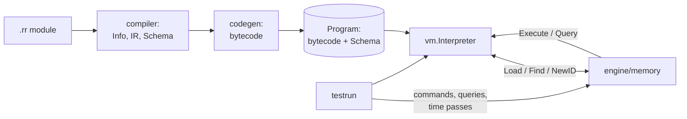

# Plan: the ReasonR interpreter and in-memory engine

| | |
|---|---|
| **Basis** | [RFC-0001](../rfc/0001-reasonr-language/README.md), stage 2 of the implementation plan (§38): "Interpreter + in-memory engine"; [the compiler plan](0001-compiler.md), stage 10 (bytecode) |
| **Status** | Approved 2026-10-03 with all the decisions of [§2](#2-decisions-to-approve). Done; progress and deviations from the plan — [0002-interpreter-progress.md](0002-interpreter-progress.md) |
| **Date** | 2026-10-03 |
| **Implementation language** | Go 1.23+ |
| **Note** | Paths, package names and RFC section numbers are those of the time (the repository `tycheg/reasonr` before the split) |

---

## Contents

1. [Goal and scope](#1-goal-and-scope)
2. [Decisions to approve](#2-decisions-to-approve)
3. [Architecture](#3-architecture)
4. [Repository layout](#4-repository-layout)
5. [Stage 1. Values, arena, boundary types](#5-stage-1-values-arena-boundary-types)
6. [Stage 2. Bytecode](#6-stage-2-bytecode)
7. [Stage 3. VM: pure computation](#7-stage-3-vm-pure-computation)
8. [Stage 4. VM: commands and the unit of work](#8-stage-4-vm-commands-and-the-unit-of-work)
9. [Stage 5. In-memory engine](#9-stage-5-in-memory-engine)
10. [Stage 6. Test runner and `reasonr test`](#10-stage-6-test-runner-and-reasonr-test)
11. [Stage 7. Performance: 0 allocations](#11-stage-7-performance-0-allocations)
12. [Stage 8. Reliability](#12-stage-8-reliability)
13. [Testing](#13-testing)
14. [Schedule and milestones](#14-schedule-and-milestones)
15. [Risks](#15-risks)
16. [Acceptance criteria](#16-acceptance-criteria)

---

## 1. Goal and scope

**Goal:** run a compiled model — the base one or a tenant's — and run its scenario tests in memory, in milliseconds:

1. **the interpreter** (VM) — an implementation of `reasonr.Interpreter` (RFC §30.2): "a command + data access → a unit of work or errors", "a query → a value or errors";
2. **the in-memory engine** — an implementation of `reasonr.Env` (RFC §30.4) and of the engine loop (RFC §30.6) in memory: storage, indexes and search, uniqueness, timers, capturing notifications and external requests, `forget`;
3. **the test runner** — `reasonr test` (RFC §27.3, `--engine memory`).

**In the plan:**

- the boundary types `Value`, `Record`, `UnitOfWork`, `Env`, `Interpreter` in the package `reasonr`;
- `Dec128` — a decimal on two `uint64`s;
- bytecode generation from the IR (stage 10 of the compiler plan) and a disassembler;
- the VM: every IR operation, including effects, `on` reactions, tenant rules, migrations and tests;
- the in-memory engine and the test runner, `reasonr test` in the CLI;
- 0 allocations per typical command, benchmarks in CI.

**Not in the plan** (the next stages of RFC §38):

- the PostgreSQL engine, the HTTP API, `--engine http` (RFC stage 3);
- personal data encryption and blind indexes (stage 4): the in-memory engine only **imitates** `forget` ([§9.6](#96-personal-data));
- Kafka and the integration service (stage 5), the UI and `--engine web` (stage 6);
- compiling to Go (RFC stage 10).

---

## 2. Decisions to approve

The RFC left several execution questions open. The decisions below are **approved** (2026-10-03) — the "Proposed decision" column is accepted; they go into the RFC, like the decisions of §2 of the compiler plan.

| # | Question | Proposed decision | Alternative |
|---|---|---|---|
| 1 | The precision of `decimal` ("128 bits, up to 38 significant digits", RFC §7.1) does not define the scale and rounding | **A fixed scale of 18**: a value is a 128-bit integer divided by 10¹⁸ (up to 20 digits before the point and 18 after). `+`, `-` are exact; `*` and `/` round the result to 18 digits **half to even** (banker's rounding); `round(x, n)` rounds **away from zero** (as in accounting). Overflow is an execution failure | A floating scale (mantissa + exponent) — more precise for very large and very small numbers, but more complex and slower, and `Value` has no room for an exponent |
| 2 | The iteration order of `set` and `map` in `for` is not defined, and execution must be deterministic (RFC §24.3) | **Insertion order.** `with` of an existing element does not move it, `without` removes it. Equality of sets and maps does not depend on order | Ascending key order: independent of history, but more expensive and needs an order on every key type |
| 3 | Execution limits: `loop.guard`, the depth of nested calls, the size of a unit of work | The engine sets the limits; exceeding one is an execution failure (`internalError`). Defaults: 100,000 loop iterations per unit of work, command call depth 64, 10,000 events, 1,000 timers, 1,000 notifications and external requests per unit of work | Limits in the model — contradicts the principle "infrastructure is the engine's business" |
| 4 | How strict the `then` checks are (RFC §27.1 says only "expected errors, notifications…") | **Errors — exactly:** the errors of the `when` step must equal the ones listed in `then` as a set; an unexpected error fails the test. **Notifications and external requests — "contains":** every expected one must be found, extra ones are allowed. Only the arguments written are compared (partially, like `matches`). An error in a `given` step fails the test with a message | Everything "contains": shorter tests, but they miss unexpected errors — and an error cancels all effects, which is almost always a bug |
| 5 | Where access is checked (`self`, `<field>`, `<Actor>`, a role). RFC §30.6 checks it in the engine before `Execute`, but access by field (`command(customer)`) needs the entity state | **The interpreter checks it** at the start of a public command or query called from outside (`CallerUser`): the state is already loaded. A violation is the built-in error `forbidden`. The engine only authenticates (`Caller`). The engine loop example in RFC §30.6 changes | The engine loads the entity itself and checks before `Execute` — a double load and the rules duplicated in every engine |
| 6 | Value lifetimes: `Value.Ref` points into the arena of the unit of work, while `Env.Load` returns a `Record` from the engine's storage | **The arena is passed to the engine:** `Env.Load` and `Env.Find` write records into the arena of the current unit of work; `Outcome` is valid until the engine calls `Release()`, after which the arena goes back to the pool. The signatures of RFC §30.2 and §30.4 change | The engine returns its own records and the interpreter copies them into the arena — extra copying and a second memory model |
| 7 | VM registers: in the compiler plan (§15, item 1) — separate banks by kind (`int64`, `float64`, `dec128`, ref) | **One register file `[]Value` per frame.** Typed instructions do not check the kind anyway; banks by kind — only if a profile shows a gain | Banks by kind from the start — more complex register allocation and calls |
| 8 | Collections: RFC §29.2 — small ones are copied in the arena, large ones are a HAMT | **Copying in the arena only, at first** (collections in models are small). A HAMT — if benchmarks show quadratic behavior on real data | A HAMT from the start — noticeably more code before the first result |
| 9 | `examples/bank` has no scenario tests, while the stage criterion is "the taxi tests pass" | Add bank transfer tests to RFC §26 (validation errors, `after`, a transfer between accounts, `Freeze`) and sync `examples/` | Bank tests only in the interpreter's `testdata`, the RFC untouched |

---

## 3. Architecture

### 3.1. Pipeline



1. **The compiler** gives the IR, the schema and (new) the bytecode: `compiler.Model` → `codegen.Generate(ir, schema)` → `*bytecode.Program`.
2. **The VM** runs the bytecode. It is pure: everything outside goes through `Env`. The VM state is only the frames and the arena of the current unit of work.
3. **The engine** calls `Execute`/`Query`, commits the unit of work (versions, uniqueness), then "delivers" notifications and external requests (the in-memory engine records them), keeps the clock and the timers.
4. **The test runner** runs the IR test functions (`test.cmd`, `test.query`, `test.time`, `expect.*`) through an engine driver interface. The `memory` driver calls the engine directly; later the `http` driver does the same through the API — the tests do not change (RFC §27.3).

### 3.2. Principles

1. **The interpreter is deterministic.** The same call with the same `Env` gives a byte-identical unit of work: `now` and identifiers come from the engine, the iteration order of collections is defined (decision 2), there is no access to clocks, randomness or Go `map`s without sorting. The test runner can run every unit of work twice and compare (`--check-determinism`).
2. **Errors ≠ failures.** Business errors (`error …`, `forbidden`, a uniqueness violation) are the result `Outcome.Errors`. An execution failure (overflow, division by zero, a `check` violation inside logic, an exceeded limit, an `Env` error) is the `error` of `Execute`; the engine answers `internalError` (RFC §7.5, §9.2). The VM does not panic: a panic inside is a bug, caught by fuzz tests.
3. **A garbage-free hot path** (RFC §29.1): frames and arenas from pools, `Value` without `interface{}`, strings and collections in the arena. Allocations are acceptable when a program is loaded and in the engine on commit.
4. **A program per tenant.** The base program is shared; a tenant's program is the base + the extension (fields at the end of the record, tenant rules, `on` reactions). The numbers `TypeRef`, `FieldRef`, `MethodRef` come from the schema of its own model.
5. **No external dependencies.** The Go standard library.

### 3.3. What changes in the RFC

After the decisions of [§2](#2-decisions-to-approve) are approved: §7.1 (decimal), §7.2 (the iteration order of `set`, `map`), §24.3 (limits), §27.1 (the strictness of `then`), §30.2–§30.4 (the arena, `Release`, access in the interpreter), §30.6 (the engine loop without `authorize`), §26 (bank tests).

---

## 4. Repository layout

```
value.go, uow.go, env.go     package reasonr: Value, Record, UnitOfWork, Env, Interpreter, Caller… (RFC §30)
arena.go                     reasonr.Arena: the bytes and values of a unit of work, a pool
runtime/
  dec/                       Dec128: arithmetic, parsing and printing, rounding
  bytecode/                  the program format: instructions, constant pool, function tables, encoding, disassembler
  vm/                        the interpreter: frames, the execution loop, effects, the unit of work, access
  record/                    canonical binary encoding of records (storage, NDJSON export later)
compiler/codegen/            IR + Schema → bytecode (stage 10 of the compiler plan)
engine/
  memory/                    the in-memory engine: storage, indexes, uniqueness, timers, outbox, forget, migrations
testrun/                     scenario tests: the engine driver, the then checks, a text/JSON report
cmd/reasonr/                 reasonr test, reasonr build --dump-bytecode
```

Every file is under 1000 lines; the VM is split by operation group (`arith.go`, `coll.go`, `str.go`, `effects.go`, `calls.go`, `find.go`…).

---

## 5. Stage 1. Values, arena, boundary types

### 5.1. Boundary types

Into the root package `reasonr` (next to `schema.go`) go the types of RFC §30.1–§30.4 with the changes of decision 6:

```go
type Interpreter interface {
	Schema() *Schema
	Execute(ctx context.Context, call CommandCall, env Env) (*Outcome, error)
	Query(ctx context.Context, call QueryCall, env Env) (*QueryOutcome, error)
}

// Outcome and QueryOutcome refer to the arena of the unit of work: the engine
// reads them and calls Release, after which the values are invalid.
func (o *Outcome) Release()

type Env interface {
	Load(ctx context.Context, a *Arena, t TypeRef, id Value) (state Record, version uint64, exists bool, err error)
	Find(ctx context.Context, a *Arena, q FindSpec) (Rows, error)
	NewID(ctx context.Context, a *Arena, t TypeRef) (Value, error)
}
```

### 5.2. Value and the arena

- `Value{Kind, Type, Lo, Hi, Ref}` — as in RFC §30.1. Scalars live in `Lo`/`Hi`: `int`/`bigint` — two's complement, `float` — `Float64bits`, `decimal` and `uuid` — 128 bits, `date` — days since 0001-01-01, `time` — nanoseconds since midnight, `timestamp` — Unix nanoseconds, `duration` — nanoseconds, `enum` — the value number, `bool` — 0/1.
- `Arena` — two growing buffers: `[]byte` for strings and `bytes`, `[]Value` for record fields and collection elements. `ArenaRef{Off, Len}` is an offset into the right buffer (by `Kind`). The high bit of `Off` marks the program's **static** arena: constant strings and values are not copied.
- `Record` keeps its fields in the arena; `Arena.Fields(r)` returns a slice without copying.
- Strings compare byte by byte, collections and records structurally (RFC §7.5). A value hash — for `set`, `map` and the engine's indexes.
- An arena pool: `Arena.Reset()` zeroes the lengths and keeps the buffers — no allocations in the steady state.

### 5.3. Dec128

`runtime/dec`: scale 18 (decision 1), the operations `Add`, `Sub`, `Mul`, `Quo`, `Neg`, `Cmp`, `Round(n)`, `Floor`, `Ceil`, conversions from and to `int64`, `float64`, strings; overflow is a flag the VM turns into a failure. Tests — a comparison with `math/big` on random values (fuzz), edge cases (±(10³⁸−1)·10⁻¹⁸, a division with a remainder of exactly 0.5).

### 5.4. Canonical record encoding

`runtime/record`: a record → bytes and back (into the arena) without reflection, by the schema: varints, string lengths, nested records and collections. Used by the in-memory engine (storage), later by the PostgreSQL engine and export. Test: `decode(encode(r)) == r` on every schema type, fuzzing of the decoder.

**Done when:** the boundary types and the arena are covered by tests; `Dec128` passes fuzzing against `math/big`; the record codec has a round-trip test and fuzzing.

---

## 6. Stage 2. Bytecode

Stage 10 of the compiler plan; the format is designed together with the VM.

### 6.1. The program

```go
type Program struct {
	Schema    *reasonr.Schema
	Funcs     []Func        // commands, apply, queries, rules, methods, check, reactions, migrations, tests
	Commands  []FuncIndex   // by (TypeRef, MethodRef): the command function
	Applies   []FuncIndex   // by event: the apply function
	Reactions [][]FuncIndex // by event: the on reactions
	Consts    Arena         // the static arena: strings, records, constant collections
	Hash      [32]byte
}

type Func struct {
	Name    string
	Kind    FuncKind
	Params  int    // the first registers
	Regs    int    // the frame size
	Code    []uint32
	Finds   []FindTemplate   // search templates (RFC §30.4) with register numbers
	Calls   []CallSite       // the call table: type, method, argument layout
	Access  []reasonr.Access // the access of public commands and queries
	Lines   []LineEntry      // code offset → source position (failure traces)
}
```

### 6.2. Generation

1. **Numbers.** IR names (`Order.place`, `field status`) are replaced by `TypeRef`, `MethodRef`, `FieldRef`, `IndexRef` from the model's schema — a tenant's own for a tenant.
2. **Register allocation** — linear scan over the live ranges of IR slots; one register file (decision 7). Parameters take the first registers.
3. **Encoding** — 32-bit words: an 8-bit opcode + three 8-bit operands; numbers over 255 get a `WIDE` prefix. Constants come from the pool by index. Instructions with a variable number of operands (calls, events, `val.new`) refer to an entry in `Calls` with the argument layout.
4. **Typed opcodes** — one per "operation × kind" pair of the IR (`add.i`, `add.dec`, `eq.str`…): the VM does not check the kind.
5. **Superinstructions** — from a profile of the examples, not before stage 7: the candidates are `field` + `ne.enum` + `br` and `opt.isnone` + `br`.
6. **Deterministic serialization** with a format version and a hash; `reasonr build --dump-bytecode` prints the disassembled code.

**Done when:** the bytecode of the examples (the base and `acme`) is generated deterministically, passes the verifier (register types, jump targets, table numbers) and matches the golden disassembly; fuzz: any IR from `FuzzLower` gives valid bytecode.

---

## 7. Stage 3. VM: pure computation

First, everything that does not change state: this tests the VM loop, the arena and the standard library.

| Group | Operations |
|---|---|
| Data | `move`, constants, `rec.get`, `val.new` (with the `check`), `val.get`, `coll.list/set/map`, `coll.len`, `coll.get`, `coll.append`, `in.*`, `opt.isnone`, `not`, `id.conv` |
| Arithmetic and comparisons | `int` — 32 bits with an overflow check, `bigint` — 64 bits, `decimal` — `Dec128`, `float`, time (`timestamp ± duration`, differences), comparisons of every kind, structural `eq` |
| Control | `br`, `jmp`, `ret`, `ret.val`, `loop.guard` |
| Standard library | every `intrinsic` (RFC §8.3, item 42 of the compiler progress): strings (`matches` — `regexp` with a cache of compiled expressions per program), collections, time, `round`, conversions, `str.concat` |
| Calls | `rule.call`, `method.call`, `query.call`; frames from a pool, the call depth is limited |
| Reads | `rec.load` and `find` in queries: the `FindSpec` template is filled with register values; `page.with`, cursors |

- **A value object's `check`:** on `val.new` inside logic a violation is an execution failure; when checking the arguments of a call from outside — `invalidArgument(path, rule)` (RFC §9.2).
- **`Query`** is complete in this stage: access (decision 5), arguments, a result or errors.

**Done when:** every query, rule and method of `examples/` runs on an `Env` stub with prepared records; a test table for every operation and `intrinsic`; failures (overflow, division by zero, `check`, a limit) return an error with a source position.

---

## 8. Stage 4. VM: commands and the unit of work

### 8.1. Entities in the unit of work

- **Loaded once** (RFC §24.3): a table "(type, id) → state" in the unit of work. The first `[x]`, command call or `ref.exists` loads the record through `Env.Load`; later ones read the table.
- **The snapshot and the current state.** A command sees a snapshot of the fields as of its start (`field`); `after` and `after.field` are the state with this command's events applied; a nested call of a command of the same entity starts from the current state (RFC §11.5). Implementation: an entity in the unit of work has its current state; a command frame holds a reference to its snapshot (a copy of the fields in the arena on entering the command — only if the command reads fields after raising an event; otherwise no copy is needed — codegen decides by the presence of `field` after `event`).
- **`event`** calls the `apply` function on the current state and appends the event to the entity's list with the sequence number of the unit of work. An entity "exists" if it has at least one event (RFC §10.3).
- **`[id]` in one's own command** — whether the entity existed at the start of the command.

### 8.2. Effects

| Operation | What it does |
|---|---|
| `error` | Appends an error; `hasErrors` — whether the unit of work has errors. Execution goes on (RFC §11.4) |
| `notify [to]` | A notification; with `to` equal to none it is not sent (RFC §13) |
| `cmd`, `cmd?` | Calling an entity's command: loading, a frame, a recursion check — statically forbidden, but the VM checks the depth |
| `proj.upsert`, `proj.delete` | Projection operations in order, only the fields passed (RFC §16) |
| `schedule`, `timer.delete` | The timer's `NewID`, the timer operation; deleting `none` or a timer that does not exist — no error (RFC §15) |
| `request` | An external request with an idempotency key (deterministic: the unit of work id + a number) |
| `forget` | The subject goes into the `Forget` list |
| `react` | The extension's `on` reactions to the events this function raised, in the order raised |

### 8.3. Access and calls from outside

- A public command called from outside checks access (decision 5): `self`, a field (by the state before the command), the actor type (`me`), a role. A violation is `forbidden`, with no effects.
- The arguments of a call from outside are checked by the schema: missing ones get their default values (the schema's `Literal`), value object `check`s give `invalidArgument`.
- A timer calls a command with `CallerTimer`: access is not checked, and there is no initiator for notifications without `to` — they are not sent (W1006 warns about this at compile time).

### 8.4. Migrations

`FuncMigration`: `all T` — identifiers through `Env` (a new method `All`, or `Find` without an index); each iteration of the top-level loop is a separate unit of work (RFC §32, item 3). Interface: `Interpreter.Migrate(ctx, name, env, commit func(*Outcome) error)`.

**Done when:** every command of `examples/` runs on an `Env` stub; golden dumps of units of work for a set of scenarios (`testdata/uow/*.rr` with calls and an expected dump) — one for every command capability of RFC §11.2 and for the tenant reactions.

---

## 9. Stage 5. In-memory engine

`engine/memory` — `Env` and the engine loop of RFC §30.6 in memory. It is also the reference behavior for the PostgreSQL engine.

### 9.1. Storage and versions

- Entities and projections — by type and id: the canonical record encoding ([§5.4](#54-canonical-record-encoding)), a version, whether it exists. `Load` decodes the record into the arena.
- **Committing** a unit of work is atomic: version checks (optimistic locking) → uniqueness checks → applying states, projections, timers → "delivery". On a version conflict `Execute` is repeated (RFC §30.6). The engine is single-threaded under a mutex, but a test can cause a conflict (a hook before commit) — the retry path is tested.
- Events are stored (a journal per entity) — for debugging and a future export.

### 9.2. Indexes and search

- Each index has an ordered structure (an in-memory B-tree or a sorted slice with binary search) over the index keys, respecting `desc`; it is updated on commit.
- `Find`: a prefix of equalities + a range on the next key, `in` — a union of ranges, the sort — the index order, `limit` or a page with an opaque cursor (the last key + id, base64). A search without an index (item 41 of the compiler progress) is a full scan in id order.

### 9.3. Uniqueness

A unique index is checked on commit: a violation is the business error from `IndexInfo.Error` with arguments from the key fields; the effects are dropped (RFC §30.6, the example "The car plate is unique").

### 9.4. Clock and timers

- The engine clock is set explicitly (`SetNow`, `Advance`): the test runner controls time.
- Timers are a queue by (`at`, scheduling order). `Advance(d)`: while there is a timer with `at ≤ now + d` — move the clock to its `at` and run its command as a separate unit of work (`CallerTimer`, `now = at`); timers scheduled meanwhile that fall into the window fire too. At the end the clock = `now + d`.
- A deleted or fired timer does not fire.

### 9.5. Notifications and external requests

After commit the engine writes them to a "delivery" journal with the unit of work number. A notification without `to` is addressed to the initiator of the root command (`Caller.Subject`). The test runner reads the journal; `reasonr test -v` prints it.

### 9.6. Personal data

No encryption (RFC stage 4). `forget` after commit marks the subject as forgotten; `Load` and `Find` return that subject's personal fields (by the schema's `Personal`) as `none`, and unique indexes over them are released. This is enough for the test "After the personal data is deleted the phone cannot be read".

### 9.7. Identifiers and tenants

- `uuid` — a deterministic generator (a counter + the run seed) so that test reports are reproducible; `sequence` — a counter per type; `string` and composite ones are set by the caller.
- The engine keeps a program per tenant; tenant data is separated (separate stores).

**Done when:** the engine passes the `Env` test suite (loading, versions and retry, search with every kind of condition and page, uniqueness, timers, `forget`); the units of work of the examples are committed and read back.

---

## 10. Stage 6. Test runner and `reasonr test`

### 10.1. Running tests

An IR test function runs in the VM like any function, and the `test.*` and `expect.*` operations call a **driver**:

```go
type Driver interface {
	Command(ctx context.Context, call TestCommand) (Result, error) // given / when: a command on behalf of an actor or a role
	Query(ctx context.Context, call TestQuery) (Result, error)
	Advance(ctx context.Context, d time.Duration) (Result, error)  // time passes
	NewID(ctx context.Context, t reasonr.TypeRef) (reasonr.Value, error)
}
```

`Result` — the errors, notifications, external requests and the query result of a step. Each test gets a new engine (isolation); the clock starts at a fixed moment.

### 10.2. Checks

- A `given` step with errors fails the test: "given, step 3: [d1].GoOnline() as d1 — error driverNotRegistered".
- `then` — by decision 4: errors exactly, notifications and external requests "contains", only the arguments written; `matches` — a partial comparison of a value object (nested records recursively), a query in `then` runs after `when`.
- A failure shows the expectation, the actual values of the step and the position in the test source.

### 10.3. Tenants

`--tenant acme`: the tenant's program, the base tests (except `exclude test`) and the extension's tests. `--all-tenants` — the base and every tenant.

### 10.4. CLI

```
reasonr test [--tenant name | --all-tenants] [--run regexp] [--format text|json] [--lang code] [-v] [--check-determinism] [path]
```

- Text output — like `go test`: `ok`/`FAIL` per test, details of the failures; `-v` — steps, notifications, requests.
- `--format json` — for agents: tests, results, failures with positions; the format is described in `AGENTS.md` (version 1), and the agent loop gets a `reasonr test` step.
- Exit codes: 0 — all passed, 1 — failures or compile errors, 2 — a failure of the tool.
- The LSP may later show tests (code lens) — outside this plan.

**Done when:** the 6 tests of `examples/taxi` pass on the base model and on `acme`; the bank tests (decision 9) pass; a set of "broken" tests in `testdata` fails with the expected messages.

---

## 11. Stage 7. Performance: 0 allocations

| Metric | Goal |
|---|---|
| Allocations per typical command in the steady state (`Execute` with an `Env` stub, an arena from the pool) | **0** (`testing.AllocsPerRun`, checked in CI) |
| A typical taxi command (`OrderTaxi`, `Accept`) on an `Env` stub | < 2 µs on Apple M1 |
| A query with an index search over 20 rows | < 5 µs excluding the engine |
| All `examples/taxi` tests in `reasonr test` | < 50 ms |
| Committing a unit of work in the in-memory engine | no goal: the engine is not on the production hot path |

The order of work: profiling (`pprof`) on command and query benchmarks → frame and arena pools → removing snapshot copies → superinstructions ([§6.2](#62-generation), item 5) → register banks (decision 7) and a HAMT (decision 8) — only if the goals are missed.

**Done when:** the goals of the table are met; benchmarks and the allocation check run in CI.

---

## 12. Stage 8. Reliability

- **VM fuzzing:** models from the `FuzzLower` corpus + random calls of public commands and queries with random arguments on the in-memory engine → no panics, failures only of the expected kinds, a repeated run gives the same unit of work.
- **Bytecode fuzzing:** `Decode` does not panic on any input; the verifier rejects invalid programs before they run.
- **Engine properties:** random command sequences — after commit `Load` returns a state equal to the fold of the events (`apply` over the journal); the indexes agree with the storage.
- **Failure traces:** the model call stack (functions and source positions from `Lines`) in the error of `Execute`.

**Done when:** the fuzz tests ran for an hour without failures; the engine properties are checked in CI with a short run.

---

## 13. Testing

| Kind | What it checks | How |
|---|---|---|
| Unit tests | `Dec128`, the arena, the codec, every VM operation and `intrinsic` | Table tests, comparison with `math/big` |
| Golden | The bytecode disassembly of the examples; unit of work dumps of the scenarios | `testdata/`, the `-update` flag |
| Unit of work scenarios | Every command capability (RFC §11.2), tenant reactions, access, failures | Small modules in `testdata/uow/` + calls + an expected dump |
| Scenario tests | The RFC examples and "broken" tests | `reasonr test` on `examples/` and `testdata/` |
| Determinism | Equal inputs → equal units of work | `--check-determinism` in every CI test |
| Fuzz | `Dec128`, the codec, the bytecode, the VM, the engine | [§12](#12-stage-8-reliability); a short run in CI, `make fuzz` |
| Benchmarks | Time and allocations | [§11](#11-stage-7-performance-0-allocations), checked in CI |

---

## 14. Schedule and milestones

Estimates for two engineers, in working weeks, ±30 %.

| Milestone | Stages | Duration | Result |
|---|---|---|---|
| **R1** | 1 | 1.5 wk | `Value`, the arena, the boundary types, `Dec128`, the record codec |
| **R2** | 2, 3 | 3 wk | Bytecode and the VM of pure computation: the queries, rules, methods of the examples on a stub |
| **R3** | 4 | 2.5 wk | Commands and the unit of work: every command of the examples, golden dumps |
| **R4** | 5, 6 | 3 wk | The in-memory engine and `reasonr test`: the taxi (base and `acme`) and bank tests pass |
| **R5** | 7, 8 | 2 wk | 0 allocations, benchmarks and fuzzing in CI |

**Total:** about 12 calendar weeks for two people. The first end-to-end result — an example query on a stub — at the end of R2; `reasonr test` on taxi — at the end of R4.

**End to end before complete:** as with the compiler, first the whole pipeline on a subset (fields, commands, events, `if`, errors, `[x].cmd()`, one test), then extension operation by operation.

---

## 15. Risks

| Risk | Likelihood | Mitigation |
|---|---|---|
| 0 allocations is unreachable with `[]Value` and collection copying | Medium | Benchmarks from R2; fallbacks — register banks and a HAMT (decisions 7, 8) |
| The semantics of the snapshot and `after` in reentrant calls are implemented wrong | Medium | Unit of work scenarios for every rule of RFC §11.5; the property "state = fold of events" |
| The bytecode format has to change | High | A format version; programs are not stored for long before the PostgreSQL engine; the golden disassembly catches changes |
| The decisions of §2 change after the implementation | Medium | Approve them before R2; decimal and collection order are isolated in `runtime/dec` and the collection operations |
| The in-memory engine drifts from the future PostgreSQL engine in behavior | Medium | The `Env` test suite is written engine-independent and later runs on PostgreSQL |
| The tests of the RFC examples turn out wrong (the model does not do what the test expects) | Medium | Fixes go into the RFC and `examples/`, as with the compiler |

---

## 16. Acceptance criteria

1. `reasonr test examples/taxi` and `reasonr test --tenant acme examples/taxi` pass every test; the bank tests pass.
2. 0 allocations per typical command in the steady state and the goals of [§11](#11-stage-7-performance-0-allocations) — checked in CI.
3. Execution is deterministic: `--check-determinism` passes on every test.
4. Every IR operation is covered by a VM test; every command capability of RFC §11.2 by a unit of work scenario.
5. The fuzz tests (`Dec128`, the codec, the bytecode, the VM, the engine) ran for an hour without failures.
6. The decisions of [§2](#2-decisions-to-approve) are in the RFC; `AGENTS.md` describes `reasonr test` and its JSON.
