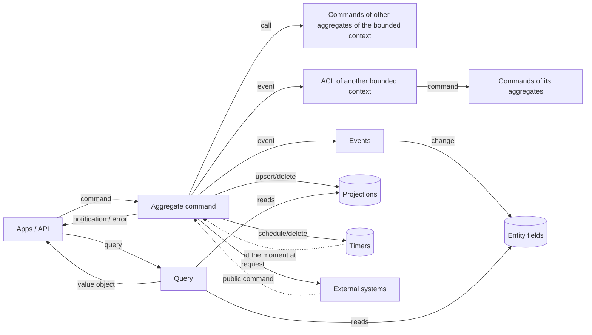

## 1. Summary

ReasonR is a strongly typed interpreted language for business logic. Structure is set by indentation, as in YAML; a colon is used only to pass arguments. A ReasonR program — a **model** — describes **what** the system does: entities, commands, events, queries, projections, timers, integrations and the user interface. The model does not describe **how** all of this is stored, delivered or drawn.

The **engine** takes care of technology: storage, transactions, delivery, the HTTP API, UI rendering, calls to external systems, encryption, tenant isolation. The same model can run on different engines: on PostgreSQL with one ACID transaction, on a sharded store, or entirely in memory for tests.

The roles are:

- the **product engineer** builds a feature end to end: writes the model, possibly together with an AI agent, assembles the interface from ready-made primitives and writes acceptance tests. They know only ReasonR — no Go, no TypeScript. There is no separate analyst role: the product engineer is the analyst, the backend and frontend developer and the tester at once;
- **engine developers** own the generic data layer: stores, transactions, delivery, the API, encryption, tenants;
- **integration developers** write the integration service — implementations of the external systems declared in the model (§18);
- **UI developers** build interface primitives — display patterns and controls (for example, "a paged list of entities with a filter", "a multiselect with autocomplete to find an entity") from which the product engineer assembles screens;
- the **architect** controls non-functional requirements in one place — the engine.

When a feature lacks a primitive, an integration or an engine capability, the product engineer **orders** it from the developers concerned; everything else they do themselves. The goal is that product engineers build 95–99 % of features and business logic code is the largest layer of the system.

```rr
aggregate Order
  id uuid
  status OrderStatus
  driver Driver.Id?

  command assignDriver(driverId Driver.Id)
    if status != offered
      offerNoLongerValid()
      return
    driverAssigned(driverId: driverId)

  event driverAssigned(driverId Driver.Id)
    driver = driverId
    status = assigned

  error offerNoLongerValid
```

---

## 2. Motivation

### 2.1. The problem

In a typical backend, business logic is mixed with technology: ORM, transactions, retries, serialization, queues, caches. As a result:

- every feature goes through the data layer, the integration layer, the UI layer and the business logic layer anew, although 95 % of that work is the same from feature to feature;
- a requirement travels a chain of hand-offs, analyst → backend → frontend → tester → analyst, and loses meaning at every step;
- whoever understands the requirement cannot read the code and check that it is implemented correctly;
- non-functional requirements (consistency, idempotency, audit, personal data protection, performance) are smeared across the code;
- an AI agent asked to "add a feature" can break transactionality, introduce an N+1 or store personal data in the clear, and the feature author will not notice.

### 2.2. Value by role

| Role | What they get |
|---|---|
| **Product engineer** | Clear top-level code that can be read and reviewed. One person builds and owns a whole feature — logic, interface, tests. Vibe coding without the risk of catastrophic mistakes with technology |
| **Engine, integration and UI developers** | Less repetitive code: technology is written once — in the engine, the integration service and UI primitives — not in every feature. Work comes as orders from product engineers, not with every feature |
| **Architect** | Non-functional requirements live inside a comparatively small engine and are easier to watch. The model is analyzed statically: the call graph, data access and personal data flows are visible before the first run |
| **Business** | Fewer hand-offs between people. Most of the program is business logic, so it needs fewer programmers and more product engineers who vibe-code and gather requirements. More predictability: the same person describes the requirements and the code |

### 2.3. Downsides

- Building the engine takes senior specialists: distributed systems, compilers, Go performance, the frontend platform, cryptography.
- The language is deliberately limited. Whatever does not fit goes to external services.
- A new abstraction layer appears, and engine bugs affect every model.
- Tooling needs investment: LSP, diagnostics, debugging.

---

## 3. Goals and non-goals

### Goals

1. **A distilled language.** A minimum of concepts, each with one responsibility. The code is clear to a product engineer who knows no general-purpose language.
2. **A distilled engine abstraction.** The interpreter talks to the engine through a very narrow interface that can be implemented in different ways.
3. **Safety by construction.** A compiled model cannot apply changes partially, send a request to an external system before commit, query without an index or write personal data to an unprotected field.
4. **Strong typing and compile-time checks:** lexical, syntactic and semantic analysis.
5. **A high-performance garbage-free interpreter** in Go. Later — compilation to a Go plugin.
6. **Generation** of storage, migrations, the API, UI (web and mobile) and integrations from the model.
7. **Multitenancy** with custom fields and behavior without forking the base model.

### Non-goals

- A general-purpose language. No higher-order functions, generics, reflection or I/O.
- Styles and pixel layout. The model assembles screens from primitives (§22); UI developers decide how primitives look.
- Complex algorithms: routing, ML, heavy computation. They live in external services.
- Managing transactions, locks, storage, journals, encryption keys, caches. That is the engine's job.

---

## 4. Design principles

1. **Business logic is the first-level abstraction.** Whatever can be derived from the model, the engine derives.
2. **Commands return nothing.** The result of a command is events, notifications, errors and deferred effects. Only queries (`query`) read data — CQRS by construction.
3. **Only events change state.** The command decides, the event applies.
4. **All or nothing.** If a command ends with at least one error, none of its effects are applied.
5. **Outside only after commit.** Notifications and requests to external systems leave after the engine has committed the changes.
6. **Determinism.** With the same input and state, a command gives the same result. The engine provides `now` and `new`.
7. **Explicitness.** Arguments are passed by name only. Fields, arguments and variables do not shadow each other. No implicit conversions, no `null`.
8. **Minimal punctuation.** Structure comes from indentation and keywords. A colon means only "argument: value".
9. **Implementation is not the model's business.** How entities and events are stored, whether there is a command journal, which bus, which protocol, how data is encrypted and tenants are isolated — the engine decides.

---

## 5. Model overview

### 5.1. Building blocks

| Concept | Keyword | Purpose | Counterpart |
|---|---|---|---|
| Bounded context | directory `contexts/<Context>/` | Where a model lives: names and identifiers work only inside it | Bounded context (DDD) |
| ACL | `acl` | Translates another bounded context's model into this one's | Anti-corruption layer |
| Aggregate | `aggregate` | A model of a real object, a consistency boundary; public commands and queries belong to it | Aggregate (DDD) |
| Actor | `actor` | An aggregate that is a user of the system | Aggregate + identity |
| Inner entity | `entity Aggregate.Name` | A part of an aggregate with its own identity inside it | Entity inside an aggregate |
| Command | `command` | Runs business logic | Command handler |
| Event | `event` | A change of entity state | Domain event + apply |
| Notification | `notification` | A message to the client about the result | — |
| Error | `error` | A message to the client about a broken rule | Domain exception |
| Query | `query` | Reading and search; the result is a value object | Query handler (CQRS) |
| Index | `index` | A declared way to search; may be unique | — |
| Projection | `projection` | A denormalized schema for search | Read model |
| Timer | `schedule(...)` | Deferred execution of a command | Deadline / scheduler |
| Value object | `value` | An immutable value with logic | Value object |
| Enumeration | `enum` | A finite set of variants | — |
| External system | `external` | A request to someone else's system | Port |
| Role | `role` | The right to call public methods | — |
| Personal data | `personal` | Data of a subject that can be crypto-shredded | — |
| Rule | `rule` | A pure function an extension may override | Strategy |
| Extension | `extend`, `on`, `rule` | Customization for a customer: own fields and behavior | — |
| App | `app` | A frontend: who signs in, the menu, screens | — |
| Screen | `screen` | A layout of primitives bound to queries and commands | — |
| Primitive | `primitive` | A display pattern or a control; UI developers implement it | UI component |
| Migration | `migration` | A manual data migration | — |
| Test | `test` | A Given / When / Then scenario | ES tests |

### 5.2. How it fits together


