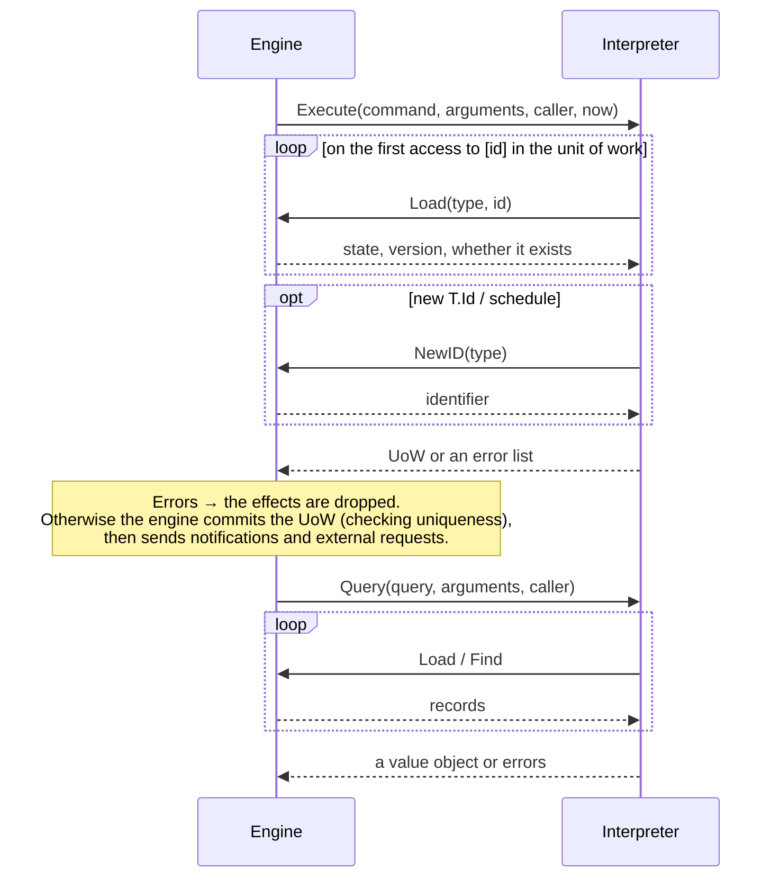

## 23. Project: parts and directories

A software product in ReasonR is a **project**: `reasonr.yaml` and the model sources (`src`). The sources are laid out in parts:

```
src/
  contexts/
    Ordering/        order.rr order.test.rr dispatch.acl.rr payments.fake.rr texts.en.rr ui.rr
    Dispatch/        trip.rr driver.rr ordering.acl.rr matching.fake.rr ui.rr
  apps/
    Admin/           app.rr
    Taxi/            app.rr
  primitives/        primitives.rr
  extensions/
    acme/            contexts/Ordering/order.rr order.test.rr
```

| Part | Directory | What is in it |
|---|---|---|
| **Bounded context** | `contexts/<Context>/` | The model: roles, enumerations, values, entities, projections, external systems, migrations; ACLs of other bounded contexts (`*.acl.rr`); screens; tests (`*.test.rr`), fakes of external systems (`*.fake.rr`), texts |
| **App** | `apps/<App>/` | One `app` named after the directory, and its texts |
| **Primitives** | `primitives/` | Primitives (`primitive`) and `default`s for every app of the project |
| **Extension** | `extensions/<name>/` | A customization for a customer (§21.2) |

- **A bounded context** is named by its directory, one capitalized word: `Ordering` (E1402). Bounded context names are unique in the project, the contexts of modules included.
- **A declaration goes in its part** (E1404): an app in `apps/`, a primitive and a top-level `default` in `primitives/`, everything else in a bounded context; texts in any part. A file outside the parts is an error (E1401).
- **A module without `contexts/`, `apps/` and `primitives/`** is flat: its `*.rr` files lie at the root and form one unnamed bounded context. The short examples of this RFC are written that way.

### 23.1. Bounded contexts

**A bounded context is where a model lives.** Inside it, each name means one thing: `Order`, its `Id`, statuses, money. A bounded context is a one-level namespace: its declaration has the full name `Ordering.Order`, `Ordering.Money`. A short name is looked up in its own context; another context is named at the start of the path: `Dispatch.Trip`. A type is not named like a bounded context (E1406). Roles are shared by the project (`admin`): authentication issues them, not a bounded context. A feature flag belongs to a bounded context (`Ordering.tips`).

**A bounded context owns its model.** An identifier, type or method of a bounded context works only inside it: a `Dispatch.Trip.Id` field in `Ordering`, a foreign value or a call of a foreign command is an error (E1407). Another bounded context sees the model only in its ACL (§23.2). Apps and primitives are outside bounded contexts, and tests call the whole project: they see everything, and a short name is looked up in the whole project and must be unique.

Same-named entities of different bounded contexts are different entities. Each bounded context declares its own common types (money, a point on the map): a change in one does not break another.

The integration knows external systems by their short name (`Matching`): it is unique in the project.

### 23.2. Anti-corruption layer

**An ACL translates another bounded context's model into this one's.** It lives in the directory of the receiving bounded context, in a `*.acl.rr` file (E1412, E1413), and names the source bounded context: `acl Ordering` (E1414). It is the only place where the names of two bounded contexts meet. Of the source, the ACL sees entities and actors — their identifiers, events and public commands — value objects and enumerations; the source's fields, projections, queries and external systems are closed (E1407): the receiver keeps the data it needs from events. Of its own bounded context — everything. When a bounded context is extracted into a service, its ACL goes with it.

ACL members:

- **`on Source.Entity.event`** — a reaction to a source event (E1415, E1416). The body sees the event arguments and `id` — the identifier of the source entity. The reaction runs in the same unit of work after the root command, in event order; reactions it triggers come next. An error in a reaction cancels the source command too.
- **`actor Source.Actor as Actor`** — a calling actor of the source acts as an actor of this bounded context with the same identifier (E1417): it passes `self` and `(Actor)` access, and `me` is the actor of this bounded context. It is not admitted to `app(Actor)`: its apps are `app(Source.Actor)`, and it sees their nodes with actor access.

Translation in an ACL:

- **An identifier — the same uuid, another type**, when the correspondence is 1:1: `Trip.Id(id)` from `Order.Id`. This is allowed only in ACLs and tests.
- **A reference by field**, when the correspondence is not 1:1 or the identifiers are of different kinds: the receiver's entity keeps the source number as an ordinary value of its model, and events carry it back.
- **Values** — with a constructor of its own type: `GeoPoint(lat: p.lat, lon: p.lon)`. **Enumerations** — by value names: `CarClass(requestedClass)`; the own enumeration must have every value of the source one (E1418).

Taxi: when an order is placed in `Ordering`, a trip with the same uuid opens in `Dispatch`; the matching progress comes back to `Ordering` as trip events (§25.3, §25.4).

**Extracting a bounded context into a separate process.** An engine process may serve some of the bounded contexts: `contexts: [Dispatch]` in `engine.yaml` (§31.1). It rejects commands and queries of other bounded contexts (HTTP 421), and ACL reactions of bounded contexts it does not have do not enter its units of work. The processes share the main store: the source event reaches the receiver's process from the effect stream, and it runs the reaction in its own unit of work — next, "at least once", without running it twice (a retry key per event). So after extraction, a reaction error no longer cancels the source command (it becomes a dispatcher dead letter), and another command may come between the command and the reaction. `reasonr extract Dispatch` lists the ACL reactions across the bounded context boundary, their commands and errors — what to check before extracting.

### 23.3. Modules

A **module** is a unit of distribution that is embedded into a project: bounded contexts, apps and primitives, engine adapters in Go and primitive implementations. A module is a directory with `reasonr.yaml`, whose `module` key is the module path, and sources `src` with the same parts as a project. A project lists modules in `reasonr.yaml`:

```yaml
requires:
  github.com/tycheg/reasonr-auth: v0.1.0
replace:                                   # a local module directory: development
  github.com/tycheg/reasonr-auth: ../../../auth
```

- The bounded contexts of a module compile into the project program together with its own: one unit of work, one store. Module tests are not part of the project.
- `reasonr mod download` downloads modules into the module cache (`REASONR_MODCACHE`, by default `<user cache>/reasonr/mod`): by git tag, directories read-only, as in Go. Versions and checksums are in `reasonr.lock`; `reasonr mod verify` checks the cache against it. `replace` substitutes a local directory — without the cache and the checksum.
- A project does not add to a module's model: it translates the model into its own with its ACL, and rules and reactions with an extension.

The first module is authentication through Keycloak (`auth/` of the repository): bounded context `Auth` with a Keycloak user and an account app; the engine checks Keycloak tokens with its built-in `jwt` authentication (the settings are in the module README). An `Auth` user in the taxi is a customer with the same identifier:

```rr
# taxi/contexts/Ordering/auth.acl.rr
# A Keycloak user (module Auth) is a taxi customer with the same
# identifier.

acl Auth
  ## An Auth user acts as a customer: passes self and Customer access,
  ## me is their customer
  actor Auth.User as Customer
```

An app over the screens of two bounded contexts — `Ordering` and the module's `Auth`:

```rr
# taxi/apps/Join/app.rr

app(Auth.User) Join "Taxi with an account"
  language en
  Menu
    JoinTaxi
    TaxiAccount
    Home
    MyAccount
```

```rr
# taxi/contexts/Ordering/account.test.rr

test "A Keycloak user becomes a customer"
  let u1 = new Auth.User.Id
  when
    [Customer.Id(u1)].Join(phoneNumber: "+79990000077") as u1
  then
    Customer.Profile() as u1 matches (phone: "+79990000077", blocked: false)

test "The customer's home address from the account"
  let u1 = new Auth.User.Id
  given
    [Customer.Id(u1)].Join(phoneNumber: "+79990000078") as u1
  when
    [Customer.Id(u1)].SetHome(address: "1 Main Street") as u1
  then
    Customer.Home() as u1 matches (address: "1 Main Street")

test "A user updates their name in the account"
  let u1 = new Auth.User.Id
  when
    [u1].Sync(userName: "Anna") as u1
  then
    User.Me() as u1 matches (name: "Anna")
```


### 23.4. Feature flags

A **feature flag** is a boolean value of a bounded context with which unfinished or new functionality ships to production switched off and is rolled out without a restart. The process:

1. A developer adds a flag with the date it was added.
2. Writes the code under the flag and tests that switch the flag on. Old tests do not change: they check the behavior with the flag off.
3. Ships the code to production with the flag off.
4. Rolls the flag out: to an actor (themselves), a role in a tenant, a tenant, everyone. If something goes wrong — switches it off.
5. Once the flag is rolled out to everyone, removes it from the code (`reasonr feature remove`).

```rr
## Tips for the driver after the ride
feature tips "2026-11-07"

aggregate Order
  command(customer) LeaveTip(amount Money)
    if tips
      tipped(amount: amount)
    else
      tipsDisabled()
```

**Declaration.** `feature <name> "<YYYY-MM-DD>"` — at the top level of a bounded context file, with a `##` description above it. The date is the day it was added, a string with an existing date (E1501). A flag belongs to a bounded context: the full name is `Ordering.tips`, in its own context — `tips`; a flag of another bounded context is read only outside bounded contexts (`Ordering.tips` in an app) and in tests — by the short name if it is the only flag with that name in the project. Extensions and modules declare flags too. A model has at most 256 flags (E1506).

**Value.** A flag reads as a `bool` in commands, queries, rules, `on` reactions and the layout of screens and apps (`Edit Order.LeaveTip if tips`). Events do not read it — replay does not depend on the rollout, the value is passed as an event parameter — nor do methods and invariants of value objects, default values, migrations and fakes (E1504). A variable, parameter or field with the same name hides the flag: then the full name is written.

**Unit of work.** The engine computes the flag set once — for the caller of the root command or query — and passes it to the interpreter in the call (`Caller.Features`, §30.2). The same set holds in nested calls and reactions: the branches of one unit of work do not diverge. A timer command and an external system's answer run with the flags of their caller (role, tenant); if a timer command needs the flag value at scheduling time, the model passes it as a parameter.

**Nesting is an error.** A condition has one flag (E1503); inside a branch of a condition with a flag, `else` included, flags are not read (E1502) — neither another nor the same one. The check is lexical: calling a command that has a flag of its own is not nesting.

**Rollout.** A flag is on for a caller if it is on at least at one level:

| Level | Command |
|---|---|
| Actor | `reasonrd feature on Ordering.tips --actor Ordering.Customer:<id> --tenant acme-prod` |
| Role in a tenant | `reasonrd feature on Ordering.tips --role admin --tenant acme-prod` |
| Tenant | `reasonrd feature on Ordering.tips --tenant acme-prod` |
| Everyone | `reasonrd feature on Ordering.tips --all` |

`reasonrd feature off Ordering.tips` switches the flag off at every level; with a level (`--actor`, `--role`, `--tenant`, `--all`) — only at that one. The engine keeps the flag state (`features` in `engine.yaml`, the main store by default), not the configuration: switching on needs no restart, engine instances learn about the change through the notification hub, and every change is written to a journal. There is one program, and the code under the flag is always in it: the fields, events and commands of new functionality are in the store schema, so switching a flag on needs no migration. `reasonrd feature list` shows the code's flags with date, age, description and rollout; flags left in the store but removed from the code are marked.

**Tests.** A line `feature tips[, …]` at the very start of a test switches the flags on for everyone in this test; in a test without it every flag is off. A flag that no test switches on is warning W1501.

```rr
test "A customer leaves a tip"
  feature tips
  given
    [o1].Complete() as d1
  when
    [o1].LeaveTip(amount: Money(amount: 100.00)) as c1
  then
    notification tipped(amount: Money(amount: 100.00)) to d1
```

**Interface.** The app API returns the current user's flags, and the runtime evaluates `if` with a flag in the layout. A UI place under a switched-off flag is hidden: `--driver web` does not find it.

**Removal.** `reasonr feature remove tips` keeps the "on" branch: it removes the conditions with the flag, the `else` branches, the declaration and the flag in the tests' `feature` lines. With `--off` the "off" branch stays, and the tests that switched the flag on are removed. Old tests that checked the previous behavior are fixed in the flag removal commit.

---

## 24. Execution semantics

### 24.1. Unit of work

Handling one external command — from the API, UI, a timer, an external system or a migration — is a **unit of work** (UoW). The interpreter runs it **purely** and returns to the engine either effects or errors:

```
UoW = {
  entities:      [(type, id, version at load, events, state after events)],
  projections:   [upsert | delete],
  timers:        [schedule | delete],
  notifications: [...],
  external requests: [...],
  forget:        [subjects]
}
```

### 24.2. Interpreter and engine interaction



The interpreter **does not know** how storage, transactions, retries, delivery, encryption and journals work. The model guarantees only one thing: if there are errors (a uniqueness violation included), the effects are not applied, and external effects leave after commit. How to achieve that is up to the engine.

### 24.3. Execution rules

- An entity is loaded once per unit of work. A repeated `[id]` returns the same one — with the accumulated events.
- Extension `on` reactions run after the command that raised the event, in the order the events were raised.
- Recursion of the same command (A → … → A) is forbidden statically. A reentrant call of another command of the same entity is allowed.
- `now` is one for the whole unit of work.
- Execution is deterministic, so the engine may safely repeat it, for example on a conflict of concurrent changes. The iteration order of collections is defined ([§7.2](02-language.md#72-composite-and-built-in-types)); the engine issues `now` and identifiers.
- Access to a public command or query called from outside is checked by the interpreter at the start of the call: the entity state for field access (`command(customer)`) is already loaded. A violation is the error `forbidden`, with no effects. The engine only authenticates the caller.
- **Execution limits** are set by the engine; exceeding one is an execution fault (`internalError`). The defaults per unit of work: 100,000 loop iterations, nesting depth of command calls 64, 10,000 events, 1,000 each of timers, notifications and external requests, 64 MB of value memory of the unit of work.
