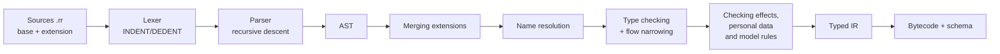

## 28. Compiler

### 28.1. Phases



1. **Lexical analysis.** Tokens, `INDENT`/`DEDENT`, no tabs or mixed indentation, duration and date literals.
2. **Syntax analysis.** LL(1), recursive descent, error recovery: one pass reports all errors.
3. **Merging extensions** with the base model.
4. **Semantic analysis** ([§28.3](#283-semantic-checks)).
5. **Generation.** Typed IR, bytecode and the schema for the engine (types, fields, indexes, personal data, API, apps and screens).

Diagnostics come with a position, an explanation and a hint; for AI agents and the LSP there is a machine-readable format `--format json`.

```
taxi/contexts/Ordering/customer.rr:44:5: error E0902: personal data is written to an unprotected place
   44 |     orderStarted(orderId: orderId, contact: phone)
      |                                             ^^^^^
   = "phone" is marked personal (subject Customer), parameter "contact" of event "orderStarted" is not
   = hint: declare the parameter as "contact string? personal"
```

### 28.2. Grammar (EBNF, abridged)

```ebnf
module        = { decl } ;
decl          = roleDecl | enumDecl | valueDecl | entityDecl | projectionDecl
              | featureDecl | externalDecl | fakeDecl | aclDecl | appDecl | screenDecl | primitiveDecl | defaultDecl | textsDecl
              | migrationDecl | testDecl
              | extendDecl | excludeDecl | letStmt ;

roleDecl      = "role" ident NL ;
featureDecl   = "feature" ident string NL ;           (* date YYYY-MM-DD, §23.4 *)
testDecl      = "test" string NL INDENT [ "feature" accessName { "," accessName } NL ]
                { letStmt } [ "given" steps ] [ "when" steps ] [ "then" checks ] DEDENT ;
enumDecl      = "enum" TypeName NL INDENT { ident NL } DEDENT ;
valueDecl     = "value" TypeName NL INDENT { fieldDecl | checkDecl | methodDecl } DEDENT ;
checkDecl     = "check" expr NL ;
methodDecl    = ident params type NL block ;

entityDecl    = ( "aggregate" | "actor" ) TypeName NL INDENT [ idDecl ] { member | onDecl } DEDENT   (* in parts — §10.8 *)
              | "entity" TypeName "." ident NL INDENT idDecl { member } DEDENT ;   (* an inner entity of an aggregate, §10.7 *)
projectionDecl= "projection" TypeName NL INDENT idDecl { member } DEDENT ;
extendDecl    = "extend" ( TypeName NL INDENT { member | onDecl } DEDENT
                         | "screen" TypeName NL INDENT { "in" TypeName NL INDENT { node } DEDENT } DEDENT ) ;
excludeDecl   = "exclude" "test" string "because" string NL ;

idDecl        = "id" ( "uuid" | "sequence" | "string" | TypeName | TypeName "." "Id" ) NL ;
member        = fieldDecl | indexDecl | commandDecl | eventDecl | notificationDecl
              | errorDecl | queryDecl | ruleDecl ;
fieldDecl     = ident type [ "=" expr ] [ personal ] [ "was" ident ] NL ;
personal      = "personal" [ "(" path ")" ] ;
indexDecl     = "index" ident "(" path [ "desc" ] { "," path [ "desc" ] } ")" [ "unique" ident ] NL ;
commandDecl   = "command" [ access ] [ "create" ] ident params NL block ;   (* create — a create command, §10.3 *)
eventDecl     = "event" ident params NL [ INDENT { ident "=" expr NL } DEDENT ] ;
notificationDecl = "notification" ident params NL ;
errorDecl     = "error" ident [ params ] NL ;
queryDecl     = "query" [ access ] ident params type NL block ;
ruleDecl      = "rule" ident params type NL block ;
onDecl        = "on" [ ident "." ident "." ] ident NL block ;   (* on placed; in an ACL — on Ordering.Order.placed, §23.2 *)
access        = "(" accessName { "," accessName } ")" ;  (* self | field | Actor | role *)
accessName    = ident [ "." ident ] ;                 (* an actor of another bounded context, outside contexts: Auth.User *)

externalDecl  = "external" [ "(" ident ")" ] TypeName NL INDENT { requestDecl } DEDENT ;   (* the system role *)
requestDecl   = "request" ident params NL ;       (* parameter timeout Timer.Id — the deadline, §18 *)
fakeDecl      = "fake" TypeName NL INDENT { fieldDecl | commandDecl | eventDecl | fakeRequest } DEDENT ;   (* *.fake.rr, §18.1 *)
fakeRequest   = "request" ident params NL block ;
aclDecl       = "acl" ident NL INDENT { onDecl | actorAs } DEDENT ;   (* *.acl.rr, §23.2 *)
actorAs       = "actor" ident "." ident "as" ident NL ;

appDecl       = "app" access TypeName [ string ] [ "auto" ] NL [ INDENT { appItem } DEDENT ] ;
appItem       = "language" ident NL | "platforms" ident { "," ident } NL | defaultDecl | node ;
defaultDecl   = "default" ( type | "id" | "enum" | "value" | "set" "<" "enum" ">" ) TypeName [ args ] NL ;
screenDecl    = "screen" TypeName [ params ] [ string ] NL INDENT { node } DEDENT ;
node          = ( primNode | fieldNode | onNode ) ;
primNode      = TypeName [ args ] [ binding ] [ string ] [ "if" expr ] NL [ INDENT { node } DEDENT ] ;   (* a primitive, a part or a screen *)
binding       = ( TypeName "." ident | ref "." ident | TypeName ) [ args ] ;                  (* a query, a command, a screen *)
fieldNode     = ident [ TypeName [ args ] ] [ string ] [ "if" expr ] NL [ INDENT { node } DEDENT ] ;
onNode        = "on" ident ( TypeName [ args ] | "back" ) NL ;
primitiveDecl = "primitive" TypeName [ typeParams ] [ primParams ] NL [ INDENT { primItem } DEDENT ] ;   (* §22.7 *)
typeParams    = "<" typeParam { "," typeParam } ">" ;
typeParam     = TypeName [ "id" | "enum" | "value" ] ;
primParams    = "(" [ primParam { "," primParam } [ "," ] ] ")" ;
primParam     = ident ( primType | params type ) [ "=" ( expr | "auto" ) ] ;   (* search(text string) list<R> *)
primType      = typeUnion | "field" "<" type [ "," type ] ">" | "screen" ;
primItem      = "binds" bindKind NL
              | "children" "binds" partKind NL
              | "part" TypeName [ "binds" partKind ] NL
              | "event" ident [ params ] NL ;
bindKind      = typeUnion | "command" | "screen" | ( "field" | "input" ) typeUnion ;   (* a bare type is a query result *)
typeUnion     = type { "|" type } ;
partKind      = type | "params" | "inputs" | "screens" ;
textsDecl     = "texts" ident NL INDENT { textKey string NL } DEDENT ;                    (* §22.11 *)
textKey       = path [ ":" path [ "#" int ] ] ;

params        = "(" [ param { "," param } ] ")" ;
param         = ident type [ "=" expr ] [ personal ] ;
type          = ( prim | TypeName [ "." "Id" ] | coll ) [ "?" ] ;
coll          = ( "list" | "set" | "page" ) "<" type ">" | "map" "<" type "," type ">" ;

block         = INDENT { stmt } DEDENT ;
stmt          = letStmt | assignStmt | ifStmt | forStmt | whileStmt | callStmt
              | deleteStmt | forgetStmt | returnStmt | "break" NL | "continue" NL ;
letStmt       = "let" ident [ type ] "=" expr NL ;
assignStmt    = ident "=" expr NL ;
ifStmt        = "if" expr NL block { "else" "if" expr NL block } [ "else" NL block ] ;
forStmt       = "for" ident "in" expr NL block ;
whileStmt     = "while" expr NL block ;
returnStmt    = "return" [ expr ] NL ;
deleteStmt    = "delete" expr NL ;                 (* [martId] or Timer.Id *)
forgetStmt    = "forget" expr NL ;
callStmt      = [ ref ( "." | "?." ) | TypeName "." ] ident args [ "to" expr ] NL ;
ref           = "[" expr "]" ;
args          = "(" [ ident ":" expr { "," ident ":" expr } ] ")" ;

searchExpr    = "[" TypeName "]" NL INDENT
                  [ "where" expr NL ] [ "sort" path [ "desc" ] { "," path [ "desc" ] } NL ]
                  ( "page" expr NL | "limit" expr NL ) "select" expr NL
                DEDENT ;
expr          = (* precedence — see §8.1; includes ref, searchExpr,
                   schedule(...), new T.Id, conversions T.Id(x) *) ;
```

### 28.3. Semantic checks

| Code | Check |
|---|---|
| E01xx | Names: namespace conflicts, field shadowing, name case (public capitalized, private lowercase) |
| E02xx | Types: incompatibility, implicit conversions, `T?` without a check, named arguments, default values, identifier fields optional only, `[x].cmd()` only with a non-optional `x` |
| E03xx | Effects: fields change only in events; events contain only assignments; queries, rules and value methods have no effects; no `now`, `new`, `schedule` or rules in events |
| E04xx | Call graph: no recursion of one command; a timer's `run` is a command of the current entity |
| E05xx | Queries: `where` and `sort` are covered by one index; the result is a value object; lists only by pages or with `limit` ≤ 100; `[T]` and `[x]` with field reads only in queries of their own type |
| E06xx | Access: parentheses only on public methods; names resolve to `self`, a field, an actor or a role; `me` only with `(<Actor>)` access |
| E07xx | Interface: primitive declarations; bindings are public methods and screens; the binding kind matches the primitive declaration; part names resolve by `binds`; arguments and the target are unambiguous, the types of same-named values match; an identifier input needs a `default`; screen parameters are filled; text keys and substitutions |
| E08xx | Tests: only public commands and `time passes` in `given`; one action in `when` |
| E09xx | Personal data: personal fields and event parameters are optional; personal data flows only to personal places with a subject of the same type; indexes on personal fields are equality only; a projection operation sets the subject field together with the personal field |
| E15xx | Feature flags (§23.4): the date added, a flag is not read in events and pure functions, flags do not nest, the test's flags are declared |
| E10xx | Extensions: additions only; the `rule` signature matches the base one; `on` refers to an existing event; `extend screen … in Part` goes to the only line of the part |
| W1xxx | Warnings: unused declarations, unreachable code, `while` without an obvious exit, command calls in a loop over an unbounded collection, `float` for money, a notification without a recipient in a timer command, a non-personal command parameter that reaches a personal field, a feature flag without a test; W13xx — interface: a node no one admitted to the app can access, an unreachable screen, a text without a translation |

---

## 29. Go runtime

### 29.1. Requirements

- The language and engine runtime (the backend) is written in Go.
- Interpreted, but high-performance.
- **Garbage-free on the hot path:** 0 allocations per typical command in steady state. The metric is `testing.AllocsPerRun` in CI benchmarks.
- Later — compilation to Go code and a plugin.

### 29.2. Interpreter architecture

| Decision | How it helps |
|---|---|
| **Register bytecode** with typed instructions (`ADD_I64`, `ADD_DEC`, `CMP_ENUM`) | Strong typing removes runtime checks and dispatch on type |
| **Fixed-size frames**; the number of a command's slots is known at compile time | Frames come from a pool, the stack does not grow |
| **`Value` without `interface{}`** (see [§30.1](#301-values)) | No boxing or allocation on assignment |
| **An arena per unit of work.** Strings, collections and records live in a bump allocator and are reset as a whole | The garbage collector sees no intermediate objects |
| **`Dec128`** — fixed-point decimal on two `uint64`s | No `math/big` |
| **Flat record layout.** The compiler computes field offsets, codecs are generated | Loading and storing without reflection |
| **Immutable collections:** small ones are copied in the arena, large ones are stored as a HAMT in the arena | `with`/`without` without a full copy |
| **A program per extension** — the base bytecode is shared, extensions are linked on top | Customization without copies of the base model |

The main loop is a `switch` on the opcode in one function, which gives predictable Go performance without a JIT.

### 29.3. Compiling to Go (future)

The same IR is translated to Go code. It can be built as `-buildmode=plugin` (Linux and macOS, one Go version, no unloading) or linked into the engine binary. The interpreter stays the reference: tests run in both modes, and the UoWs must match.

---

## 30. Engine abstraction

The interpreter is a **pure function** "command + data access → unit of work". Below are all the types on the "interpreter ↔ engine" boundary.

### 30.1. Values

```go
package reasonr

import (
	"context"
	"time"
)

// TypeRef, FieldRef, MethodRef, IndexRef are indexes in the compiled schema (Schema).
type (
	TypeRef   uint32
	FieldRef  uint16
	MethodRef uint32
	IndexRef  uint16
)

// FieldPath is a path to a field, also into a value object (car.plate).
type FieldPath []FieldRef

// Kind is the kind of a value; it matches the language types.
type Kind uint8

const (
	KindNone      Kind = iota // none of an optional
	KindInt                   // int: 32 bits
	KindBigint                // bigint: 64 bits
	KindFloat
	KindDecimal
	KindString
	KindBool
	KindUUID
	KindDate
	KindTime
	KindTimestamp
	KindDuration
	KindBytes
	KindEnum        // Lo is the value number
	KindID          // an entity identifier; inside — a uuid, bigint, string or record
	KindTimerID     // a timer identifier (uuid)
	KindRecord      // a value object, an entity or projection record
	KindList
	KindSet         // insertion order
	KindMap         // insertion order
	KindPage        // page<T>: items and next
	KindPageRequest // PageRequest: size and cursor
)

// Value is a value without boxing. Scalars are in Lo/Hi, referenced data in the arena.
type Value struct {
	Kind Kind
	Type TypeRef  // the concrete type for Enum, ID, Record
	Lo   uint64   // int, float (Float64bits), bool, enum, date (days since 0001-01-01), time (ns since midnight),
	              // timestamp (Unix seconds), duration (ns), low bits of decimal and uuid
	Hi   uint64   // high bits of decimal and uuid, timestamp nanoseconds
	Ref  ArenaRef // string, bytes, Record, collections, page, string and composite IDs
}

// ArenaRef is an offset and length in the arena: in bytes for strings, in values for records and collections.
// The high bit of Off refers to the program's static arena (constants).
type ArenaRef struct{ Off, Len uint32 }

// Arena is the memory of a unit of work: strings, record fields, collection elements.
// Buffers are reused through a pool, so the hot path does not allocate.
type Arena struct{ /* … */ }

func GetArena() *Arena                          // from the pool
func PutArena(a *Arena)                         // to the pool; the arena's values become invalid
func (a *Arena) String(s string) Value          // a copy of the string in the arena
func (a *Arena) Data(v Value) []byte            // string bytes without copying
func (a *Arena) Elems(v Value) []Value          // record fields, collection elements without copying
func (a *Arena) Record(t TypeRef, fields ...Value) Record
func (a *Arena) Copy(src *Arena, v Value) Value // a deep copy from another arena
func (a *Arena) Equal(x, y Value) bool          // structural equality (§7.5)
func (a *Arena) Hash(v Value) uint64            // consistent with Equal
func (a *Arena) Compare(x, y Value) int         // the order for indexes and sorting

// Record is a record: field values in schema order lie in the arena.
type Record struct {
	Type TypeRef // 0 — method arguments
	Ref  ArenaRef
}

// FieldValue is the value of one field (a projection row write).
type FieldValue struct {
	Field FieldRef
	Value Value
}
```

`decimal` is stored as a 128-bit integer divided by 10¹⁸ ([§7.1](02-language.md#71-primitives)). Arithmetic is package `runtime/dec`. The canonical binary encoding of records by the schema (for the engine store) is package `runtime/record`.

### 30.2. Calls and results

```go
// Interpreter runs a compiled program (the base model + an extension).
type Interpreter interface {
	Schema() *Schema
	Execute(ctx context.Context, call CommandCall, env Env) (*Outcome, error) // error is an execution fault
	Query(ctx context.Context, call QueryCall, env Env) (*QueryOutcome, error)
}

type CallerKind uint8

const (
	CallerUser      CallerKind = iota // a person or an external system with a token
	CallerTimer                       // a fired timer
	CallerMigration                   // a manual migration
	CallerTest                        // the test runner
)

// Caller is the authenticated caller. The interpreter checks access (§24.3).
type Caller struct {
	Kind    CallerKind
	Subject Value   // the actor id if the caller is an actor; otherwise KindNone
	Actor   TypeRef // the actor type; 0 — not an actor
	Roles   []string
	Tenant  string // set by the engine; the interpreter does not use it
	// Features are the caller's feature flags (§23.4): bit i is Schema.Features[i].
	// The engine computes the set once per unit of work.
	Features [4]uint64
}

// ID, Args and Caller.Subject lie in the engine arena Arena: the interpreter copies
// them into the unit of work arena, so a repeated execution uses the same call.
type CommandCall struct {
	Entity  TypeRef
	ID      Value
	Command MethodRef
	Args    Record
	Arena   *Arena
	Caller  Caller
	Now     time.Time // fixed by the engine; does not change on a repeated execution
}

type QueryCall struct {
	Type   TypeRef // an entity or projection
	Query  MethodRef
	Args   Record
	Arena  *Arena
	Caller Caller
	Now    time.Time
}

// Outcome refers to the unit of work arena: the engine reads the result
// and calls Release, after which the values are invalid.
type Outcome struct {
	Errors []BusinessError // not empty → Work == nil
	Work   *UnitOfWork
	Arena  *Arena
}

func (o *Outcome) Release() // the arena goes back to the pool

type QueryOutcome struct {
	Errors []BusinessError // not empty → Result.Kind == KindNone
	Result Value           // a value object, page or list
	Arena  *Arena
}

func (o *QueryOutcome) Release()

type BusinessError struct {
	Owner    TypeRef // the entity or projection that declared the error; 0 — built-in
	Name     string
	Args     Record
	Subjects []ArgSubject // personal data subjects in the arguments (§20.2)
}
```

### 30.3. Unit of work

```go
type UnitOfWork struct {
	Entities      []EntityChange
	Projections   []ProjectionOp
	Timers        []TimerOp
	Notifications []Notification
	Requests      []ExternalRequest
	Forget        []Subject // crypto-shredding: destroy the keys after commit
}

type EntityChange struct {
	Type    TypeRef
	ID      Value
	Existed bool    // whether the entity existed at load
	Version uint64  // the version at load (0 — did not exist)
	Events  []Event // in order
	State   Record  // the state after the events
}

type Event struct {
	Name MethodRef
	Args Record
	Seq  uint32 // the event's order among all events of the unit of work
}

type ProjectionOpKind uint8

const (
	ProjectionUpsert ProjectionOpKind = iota
	ProjectionDelete
)

type ProjectionOp struct {
	Kind       ProjectionOpKind
	Projection TypeRef
	ID         Value
	Set        []FieldValue // the fields passed (for Upsert); the rest get defaults
	Seq        uint32       // the order of operations on one row matters
}

type TimerOpKind uint8

const (
	TimerSchedule TimerOpKind = iota
	TimerDelete
)

type TimerOp struct {
	Kind     TimerOpKind
	ID       Value     // Timer.Id
	At       time.Time // for Schedule
	Entity   TypeRef   // the entity and command for Schedule
	EntityID Value
	Command  MethodRef
	Args     Record
}

type Notification struct {
	Owner TypeRef
	Name  MethodRef
	Args  Record
	To    Value // the actor id; KindNone — to the initiator of the root command
	// Subjects are the personal data subjects in the arguments (§20.2).
	Subjects []ArgSubject
}

type ExternalRequest struct {
	System  TypeRef
	Request MethodRef
	Args    Record
	Timeout time.Duration // 0 — not set
	Key     Value         // a unique request id (for idempotency at the recipient)
	// Subjects are the personal data subjects in the arguments (§20.2).
	Subjects []ArgSubject
}

// Subject is a personal data subject.
type Subject struct {
	Type TypeRef
	ID   Value
}

// ArgSubject is a personal data subject in argument Arg (the parameter
// number); an argument with data of several subjects has several entries.
type ArgSubject struct {
	Arg     int
	Subject Subject
}
```

### 30.4. What the interpreter gets from the engine

```go
// Env is implemented by each engine. The engine writes records and identifiers
// into the arena a of the current unit of work and reads arguments from it.
type Env interface {
	// Load returns an entity or projection record.
	// If there is none — default values, exists=false, version=0.
	// Personal fields of a subject whose key is destroyed come back as KindNone.
	Load(ctx context.Context, a *Arena, t TypeRef, id Value) (state Record, version uint64, exists bool, err error)
	// Find searches by an index. The compiler has already checked the spec.
	Find(ctx context.Context, a *Arena, q *FindSpec) (Rows, error)
	// NewID issues an identifier by the type's strategy (uuid, sequence); t == 0 — for a timer.
	NewID(ctx context.Context, a *Arena, t TypeRef) (Value, error)
}

type CondOp uint8

const (
	OpEq CondOp = iota
	OpNe
	OpLt
	OpLe
	OpGt
	OpGe
	OpIn
)

type Cond struct {
	Field FieldPath
	Op    CondOp
	Value Value
}

type SortKey struct {
	Field FieldPath
	Desc  bool
}

const NoIndex = ^IndexRef(0) // a search without an index

type FindSpec struct {
	Type   TypeRef
	Index  IndexRef // NoIndex — without an index
	Where  []Cond // a conjunction of conditions on index fields
	Sort   []SortKey
	Page   bool   // either a page (Size, Cursor) or Limit
	Size   int
	Cursor Value  // string or KindNone
	Limit  int    // < 0 — no limit: all T in migrations
}

type Rows struct {
	Records Value // a list of records in the arena: fields by schema, then the record id
	Next    Value // the next page cursor: string; KindNone — the end
}
```

### 30.5. Schema for the engine

The compiler builds it, and the engine creates storage, the API and encryption from it. The interface is not part of the schema: apps, screens, primitives and texts are a separate interface program, so storage, version compatibility and migrations do not concern it.

```go
type Schema struct {
	Version uint64
	Extension string // "" — the base model
	Types   []TypeInfo
	Roles   []string
	Features []FeatureInfo // feature flags by full name: the number is the bit in Caller.Features
}

type FeatureInfo struct {
	Name string // "Ordering.tips"
	Date string // the date added, YYYY-MM-DD
	Doc  string
}

type TypeKind uint8

const (
	TypeEntity TypeKind = iota
	TypeActor
	TypeProjection
	TypeValue
	TypeEnum
	TypeExternal
)

type IDStrategy uint8

const (
	IDNone     IDStrategy = iota // not an entity
	IDUUID
	IDSequence
	IDGiven   // string or composite — set by the caller
	IDDerived // based on an entity identifier (a projection with id Order.Id)
)

type TypeInfo struct {
	Ref      TypeRef
	Name     string
	Kind     TypeKind
	ID       IDStrategy
	IDType   TypeRef // a composite identifier or the base type for IDDerived
	Fields   []FieldInfo
	Indexes  []IndexInfo
	Methods  []MethodInfo
	Enum     []string // enumeration values
	Extended bool     // the type is changed by an extension
}

type FieldInfo struct {
	Ref      FieldRef
	Name     string
	Type     TypeRef
	Kind     Kind
	Optional bool
	Default  Value
	Personal *Personal // nil — an ordinary field
	WasName  string    // for renames
	Extension string   // "" — a base field, otherwise an extension field
}

type Personal struct {
	Subject     FieldPath // empty — the entity itself
	SubjectType TypeRef
}

type IndexInfo struct {
	Ref    IndexRef
	Name   string
	Keys   []SortKey
	Unique bool
	Error  string // the error name on a uniqueness violation
}

type MethodKind uint8

const (
	MethodCommand MethodKind = iota
	MethodEvent
	MethodNotification
	MethodError
	MethodQuery
	MethodRule
	MethodRequest // a request to an external system
)

type AccessKind uint8

const (
	AccessAny   AccessKind = iota // any authenticated caller
	AccessSelf
	AccessField
	AccessActor
	AccessRole
)

type Access struct {
	Kind  AccessKind
	Field FieldPath // for AccessField
	Actor TypeRef   // for AccessActor
	Role  string    // for AccessRole
}

type MethodInfo struct {
	Ref     MethodRef
	Name    string
	Kind    MethodKind
	Public  bool
	Access  []Access // any of the conditions
	Params  []FieldInfo
	Result  TypeRef // for query and rule
	Timeout time.Duration
}
```

### 30.6. The engine loop

Everything else is **the engine's internal business**: how to commit a unit of work, whether to store events, how to deliver messages, store timers, enforce uniqueness, manage encryption keys, isolate tenants, build the API and UI.

Engines are built from one **kernel** and replaceable components — ports. A transport (HTTP, gRPC) decodes a call, authenticates the caller and passes it to the **executor** (`Executor`) without knowing where the command runs: in this process's kernel or in another process. The kernel runs the command with the interpreter and commits the unit of work through the main store port:

```go
func (k *Kernel) Command(ctx context.Context, req *CommandRequest) (*CommandResult, error) {
	interp := k.programFor(req.Tenant) // the data tenant's model (§21.1); the interpreter checks access
	if req.Idempotency != "" {
		if res := k.store.Remembered(ctx, req.Tenant, req.Idempotency); res != nil {
			return res, nil // a repeated call with the same key gets the same response
		}
	}
	req.Call.Now = k.clock.Now(req.Tenant)
	for {
		out, err := interp.Execute(ctx, req.Call, k.env(req.Tenant)) // Load and Find — without a transaction
		if err != nil {
			return nil, err // an execution fault → internalError
		}
		if len(out.Errors) > 0 {
			return k.reject(ctx, req, out.Errors) // the effects are dropped; forbidden is here too
		}
		// One transaction: version checks, uniqueness, states, synchronous
		// projections, timers, forget, the outbox, the response by idempotency key.
		pos, err := k.store.Commit(ctx, req.Tenant, k.unit(req, out))
		var uv *UniqueViolation
		switch {
		case errors.As(err, &uv):
			return k.reject(ctx, req, k.uniqueError(uv)) // the error from IndexInfo.Error
		case errors.Is(err, ErrConflict):
			out.Release()
			continue // a version conflict: a repeat is safe, execution is deterministic
		case err != nil:
			return nil, err
		}
		// After commit: notifications to other actors go through the hub, to the initiator in the response.
		k.hub.Publish(ctx, req.Tenant, out.Arena, others(out.Work.Notifications, req.Call.Caller))
		return accepted(out, pos, req.Call.Caller), nil
	}
}
```

1. **The position** is an increasing number of a committed unit of work. The command response returns it. A query may pass `after` (§31.3): the response comes once the stores of asynchronous projections have applied that position.
2. **The effect stream.** External requests, asynchronous projections, the event store and event publishing get the unit of work from the outbox after commit — at least once, idempotently by position.
3. **The idempotency key.** The response to a command with a key is stored together with its unit of work. A repeated call with the same key gets the same response and does not run the command again.
4. **Timers.** A timer row is written in the transaction of the command that set it. The timer's command is committed together with deleting the row: a timer runs at least once, and its effects apply exactly once.

From day one the kernel has two main store implementations: in memory (tests, local development) and PostgreSQL (the default).
